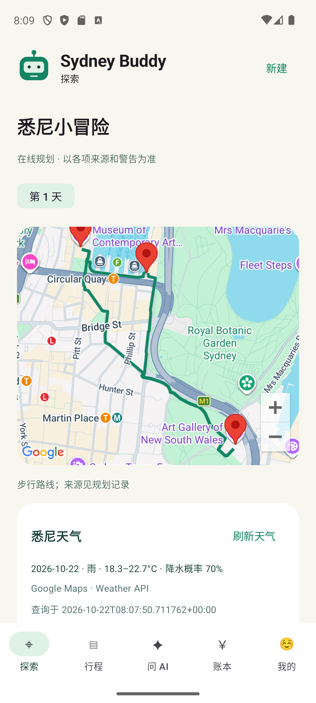

# Sydney Buddy · 悉尼旅行 Agent

原生 **Android（Kotlin + Jetpack Compose）+ Python API** 旅行规划 MVP：单题引导收集偏好，NVIDIA Nemotron 推荐候选地点，程序检查路线约束，再由用户确认保存。地图、地点、路线与天气使用 Google Maps Platform，授权偏好使用官方 Meterless H-MEM 引擎。现有 SwiftUI iOS 客户端保留在 `ios/`，Android 开发不依赖 Xcode。

本版本替换仓库原 React/.NET 原型；旧版本保留在 Git 历史中。**当前为本机单用户原型，未部署线上服务，也未提交 HackOS。**



Android 运行画面（Pixel 7 模拟器 / Android 14）；[保留的 iOS 引导截图](docs/buddy-onboarding.png)。

[旧版 iOS 地图与出发任务截图](docs/buddy-preparation.png) · [iOS Google 天气截图](docs/app-google-weather.png) · [iOS 演示录像 MP4](docs/app-demo.mp4) · [iOS 验证记录](docs/VERIFICATION.md)

## 已实现

- 8步轻量引导：日期、天数、节奏、兴趣、预算、起点、时间、确认。Buddy 即时回应，带进度条与按压反馈。
- 悉尼市区1–3天步行规划，8个限定候选地标，每天最多4站，跨天不重复。
- Google 地图标记和真实步行路线；Places 查询坐标与常规营业时段；Weather 获取未来10天逐日预报。
- Nemotron 只对给定地点ID排序，程序独立检查时间、步数、活动预算、休息、衔接和返程。
- AI调整先生成草案，展示地点与步数变化，确认后才替换保存；版本冲突返回409。
- SQLite 多行程管理；Android 和 iOS 本机均分记账以整数分保存。
- 同意后保存偏好并通过 H-MEM 检索，支持撤回；追加审计账本仍保留历史记录。
- 出发准备清单：查看路线、成功刷新天气、手动确认行李。进度按行程保存在本机，全部完成显示徽章，不设断签惩罚。

## 快速运行

### Android（Windows / macOS）

需要 Android Studio、Android SDK 35、JDK 17 或 21、Python 3.9+（含悉尼时区数据）及支持 `--experimental-transform-types` 的 Node.js（建议 24）。

1. 克隆仓库并切换到 `dev`，在 Android Studio 中打开 **`android/`** 文件夹，等待依赖同步。
2. 启动一个 Android 8.0+ 模拟器，或连接已开启 USB 调试的 Android 手机。Google 地图需要带 Google Play 服务的设备。
3. 在仓库根目录运行 `python -m pip install -r server/requirements.txt`（仅 Windows 安装时区数据），再运行 `python server/app.py`，保持这个进程运行。
4. Windows 运行 `powershell -File scripts/connect-android.ps1`；macOS 运行 `sh scripts/connect-android.sh`，将手机本机端口转发到电脑。
5. 在 Android Studio 运行 `app`。不填密钥即可走完演示流程；地图会明确标注为示意图。

Windows 也可运行 `powershell -File scripts/start-server.ps1` 启动后端。若 `adb` 不在 PATH，连接脚本会尝试从 `ANDROID_HOME` 或默认 SDK 路径查找。每次重启模拟器或重新连接手机后，需要重新转发端口。

命令行构建：在 `android/` 运行 `./gradlew.bat :app:assembleDebug :app:testDebugUnitTest :app:lintDebug`（Windows）或 `sh gradlew :app:assembleDebug :app:testDebugUnitTest :app:lintDebug`（macOS）。APK 位于 `android/app/build/outputs/apk/debug/app-debug.apk`。

真实 Google 底图需要单独的 **Maps SDK for Android** 密钥，填入被忽略的 `android/local.properties`：`MAPS_API_KEY=你的Android地图密钥`。只允许 Maps SDK for Android，并限制为包名 `com.sydneybuddy.travel` 与本机签名 SHA-1；iOS 地图密钥不通用。组员各自运行 `gradlew signingReport` 获取指纹，将需要的包名/指纹添加到 Android 密钥限制。不要共享 debug.keystore 或把密钥提交 Git。

NVIDIA 和 Google 服务端密钥仍通过电脑的 `/setup` 配置，或按 `.secrets.example.json` 创建 `.secrets.json`；它们不进入 APK。每位组员运行自己的后端和本机数据，不共享行程数据库。线上开关会选择 `live`（有 Google 服务端配置）或 `assisted`（只有 NVIDIA）；密钥配置不等于调用成功。

Android 使用相同后端接口，保留 8 步引导、草案确认、调整对比、版本冲突提示、多行程、天气刷新、按行程保存准备进度、手机本机整数分账本，以及需同意的电脑本机偏好存储。取消草案不会替换原行程，新建行程不会覆盖之前的行程。后台加载或保存时禁止切换行程，避免将返回结果写入另一份行程。

这是本机开发版本：Debug 只为 `127.0.0.1` / `localhost` 允许 HTTP，Release 禁止明文连接；后端仍仅监听回环地址。独立联网运行需要另行部署 HTTPS 服务、配置客户端地址并实现身份认证。没有声称已完成应用商店发布或所有 Android 设备兼容性验证。实际测试见 [Android 验证记录](docs/ANDROID-VERIFICATION.md)。

### 保留的 iOS 客户端（macOS）

需要 macOS、Xcode（iOS17+ SDK/模拟器）、Python3.9+（之前验证3.14）、Node.js24。macOS 的 Python 服务使用标准库，无需 pip 安装。首次 Xcode 构建需联网下载 Google Maps SDK11.2.0。

```sh
git clone https://github.com/f1sh11/hackathon.git
cd hackathon
python3 server/app.py
```

也可双击 `scripts/start-server.command`。服务启动在 [http://127.0.0.1:8787](http://127.0.0.1:8787)，然后：

1. 打开 `ios/SydneyBuddy.xcodeproj`，选择已安装的 iPhone 模拟器，运行 `SydneyBuddy` scheme。
2. 不配置密钥也能用演示模式，地图显示明确标注的示意图。
3. 配置在线服务：在同一台电脑打开 [本机密钥设置页](http://127.0.0.1:8787/setup)，填写自己的密钥并保存。
4. Google iOS地图密钥保存后，重新构建App。开启引导页或“我的”里的在线推荐。

命令行构建（先用 `xcrun simctl list devices available` 查询可用模拟器）：

```sh
xcodebuild -project ios/SydneyBuddy.xcodeproj -scheme SydneyBuddy \
  -sdk iphonesimulator -configuration Debug \
  -destination 'generic/platform=iOS Simulator' CODE_SIGNING_ALLOWED=NO build
```

模拟器无需Apple付费会员即可构建运行；真机需自己的开发团队/签名。**App中的127.0.0.1只适用于同机模拟器**。真机/线上部署需配置HTTPS后端地址、身份认证、访问控制和滥用防护，本版尚未实现。

## API 密钥配置

仓库发布完整API接口代码和配置模板，**不包含可用密钥**。本机设置页会把密钥保存到忽略文件 `.secrets.json`（权限0600），iOS地图密钥另写入忽略文件 `ios/Config/Secrets.xcconfig`。

| 配置项 | 用途与限制 |
|---|---|
| `NVIDIA_API_KEY` | 服务端调用 NVIDIA NIM；不得打包进App |
| `NVIDIA_MODEL` | 可选；默认 `nvidia/nemotron-3.5-lightning-30b-a3b`，需账号支持 |
| `GOOGLE_SERVER_KEY` | 仅允许 Places API (New)、Routes API、Weather API；部署后建议按固定服务出口 IP 限制 |
| `GOOGLE_IOS_KEY` | 仅允许 Maps SDK for iOS，应用限制为 `com.sydneybuddy.travel` |
| Android `MAPS_API_KEY` | 仅允许 Maps SDK for Android，限制 Android 包名与签名 SHA-1；仅写入 `android/local.properties` |
| `NODE_BINARY` | 可选，Node24可执行文件路径；否则从PATH查找 |

模板见 [.secrets.example.json](.secrets.example.json) 和 [Secrets.example.xcconfig](ios/Config/Secrets.example.xcconfig)。使用模板时自行复制为实际文件，填入自己的值。也可通过上述同名环境变量配置服务端；本程序**不会自动加载.env**。单独设置 `GOOGLE_IOS_KEY` 环境变量不会生成App配置，应使用设置页或手动填写xcconfig。

Google项目需要启用计费及所需服务（Android 与 iOS 地图 SDK 分别启用）。已有密钥的 IP 限制换网络后可能失效；应用密钥和服务端密钥应分开配置。团队若选择取消服务端 IP 限制以便异地测试，仍应保留三项 API 限制，密钥只私下分发。Weather、地图、Places 和 Routes 分别计费，以[官方价格](https://developers.google.com/maps/billing-and-pricing/pricing)为准。未配置云端硬性费用上限。

## 模式、天气与数据边界

| 模式 | 模型 | 其他数据 |
|---|---|---|
| `demo` | 本地规则，不调用AI | 示例地点、天气、营业时段与距离估算 |
| `assisted` | 真实Nemotron | 示例地点、天气和路线，不请求Google服务端API |
| `live` | 真实Nemotron | Google Places、Routes、Weather；费用/场内步数/停留时间仍为估算 |

在线开关开启后，有Google服务端密钥进入live，否则assisted。存在密钥不代表服务验证成功；地图SDK与后端服务分别配置。

天气按Australia/Sydney日期匹配，每天分别影响室内/室外筛选。Weather每次请求10天、pageSize=10，8秒超时；失败或范围外明确标为未知，不当作晴天。首页可独立刷新天气；刷新不会重排已保存路线，调整要点“问AI”并确认。雨天快捷按钮是用户情景测试，明确标注非实时。Google天气原始响应不做跨请求缓存。

## 后端接口

默认仅监听127.0.0.1:8787，无账户系统，不可直接暴露公网。JSON请求使用 `Content-Type: application/json`；跨站请求受本机来源检查限制。

| 方法/路径 | 说明 |
|---|---|
| `GET /health` | 服务状态、配置是否存在；不返回密钥 |
| `GET /catalog` | 8个候选地点的演示基础数据 |
| `POST /plan` | 按profile和mode生成草案，不保存 |
| `POST /weather` | 按profile日期获取Google天气，不保存或重排行程 |
| `GET /trips` | 已保存的行程 |
| `POST /trips` | `{ "trip": <草案>, "expectedRevision": 0 }`；首次保存revision1，修改时传当前revision |
| `DELETE /trips/{id}` | 删除指定行程 |
| `GET /memories` | 已保存的授权偏好 |
| `POST /memories` | `{ "consent": true, "summary": "喜欢艺术", "profile": {"interests":["艺术"],"maxSteps":5000} }` |
| `DELETE /memories/{id}` | 从可检索记忆撤回；不抹除追加审计历史 |
| `GET /setup` | 本机密钥配置表单；POST需要页面提供的CSRF令牌 |

规划请求示例（日期自行调整；live天气只支持未来10天）：

```sh
curl -s http://127.0.0.1:8787/plan -H 'Content-Type: application/json' -d '{
  "mode":"demo", "date":"2026-10-24", "days":1,
  "budget":100, "maxSteps":10000, "startMinute":600, "endMinute":1080,
  "interests":["艺术","风景"], "mustVisit":[], "request":"想多看看艺术馆",
  "start":{"name":"环形码头","lat":-33.8611,"lng":151.2126},
  "end":{"name":"环形码头","lat":-33.8611,"lng":151.2126}
}'
```

budget是每天澳元活动预算；时间用当地午夜起算分钟。约束无可行解返回422；保存版本冲突409；非法来源403。API不会预订、付款或提交赛事。

## 测试与 CI

```sh
# 先启动本机服务；HTTP测试只删除自己创建的记录
python3 -m unittest discover -s server/tests -v
# Node24，官方H-MEM conformance
HMEM_IMPL="$PWD/server/vendor/hmem/src/index.ts" \
  node --experimental-transform-types server/vendor/hmem/conformance/runner.ts
```

Android 已通过 APK 构建、6 项域逻辑测试、静态检查及 Pixel 7 模拟器界面流程测试。后端 21 项测试和官方 H-MEM 的 13 项检查也已通过。GitHub Actions 分别构建 Android APK、运行 Android 域逻辑测试及静态检查，以及执行后端和 H-MEM 测试，不调用付费服务。Android 实际在线请求与设备边界见[验证记录](docs/ANDROID-VERIFICATION.md)；之前的 iOS 构建记录见[旧版验证说明](docs/VERIFICATION.md)。

## 项目结构

```text
android/               Kotlin / Jetpack Compose Android App、Gradle Wrapper、测试
ios/                   保留的 SwiftUI App、Xcode工程、配置模板
server/app.py          本机HTTP API与SQLite存储
server/planner.py      候选收集、Nemotron排序与确定性约束检查
server/weather.py      Google天气、日期匹配与失败处理
server/memory.py        Node24 H-MEM桥接
server/vendor/hmem/    官方参考实现、许可和来源
server/tests/          后端与HTTP测试
scripts/               启动和工程生成脚本
docs/                  App截图、演示录像、验证与参赛清单
.github/workflows/     Android 构建、域逻辑与静态检查；后端自动检查
```

## 限制与黑客松状态

- 限定8个悉尼地标、步行模式，最多尝试8个候选顺序，不保证全局最优。Google常规营业时段不保证节假日正确；缺失数据使用明确标记的假设。
- 费用、步数、停留时间为估算；没有住宿、全餐饮、实时票价、排队、坡度和无障碍模型。
- 没有多人账户、社区、共享同步、支付、订票、酒店预订、航班追踪或后台GPS。出发准备徽章不等于到访认证。
- H-MEM为本机单用户；删除后不再检索，但追加审计账本保留历史。未启用自动dreaming/sleep。
- NVIDIA直连NIM和官方Meterless H-MEM已验证。**Cursor、Zetaris按团队要求暂缓，Nightshift未接入；不声称满足全部赛事要求。** 最终赛道、赞助商要求与HackOS提交仍需团队确认。[参赛清单](docs/submission-checklist.md)
- 视频是之前版本的原始录屏，没有新版任务引导、解说或全部增量功能；以源码与当前截图为准。演示稿未存入本仓库。

## 来源与许可

项目沿用[MIT许可证](LICENSE)。`server/vendor/hmem`为官方参考实现，保留独立Apache-2.0许可和[来源说明](server/vendor/hmem/UPSTREAM.md)。Google SDK及在线服务受各自条款约束。

[Google Maps iOS](https://developers.google.com/maps/documentation/ios-sdk/config) · [Places](https://developers.google.com/maps/documentation/places/web-service/text-search) · [Routes](https://developers.google.com/maps/documentation/routes/compute_route_directions) · [Weather](https://developers.google.com/maps/documentation/weather/overview) · [NVIDIA NIM](https://docs.api.nvidia.com/nim/reference/llm-apis) · [Meterless](https://github.com/Meterless/Meterless/tree/main/engines/hmem)

交互借鉴[Duolingo的小步学习、即时反馈和完成奖励](https://blog.duolingo.com/duolingo-teaching-method/)，使用原创Buddy角色；本项目与Duolingo无关联。
