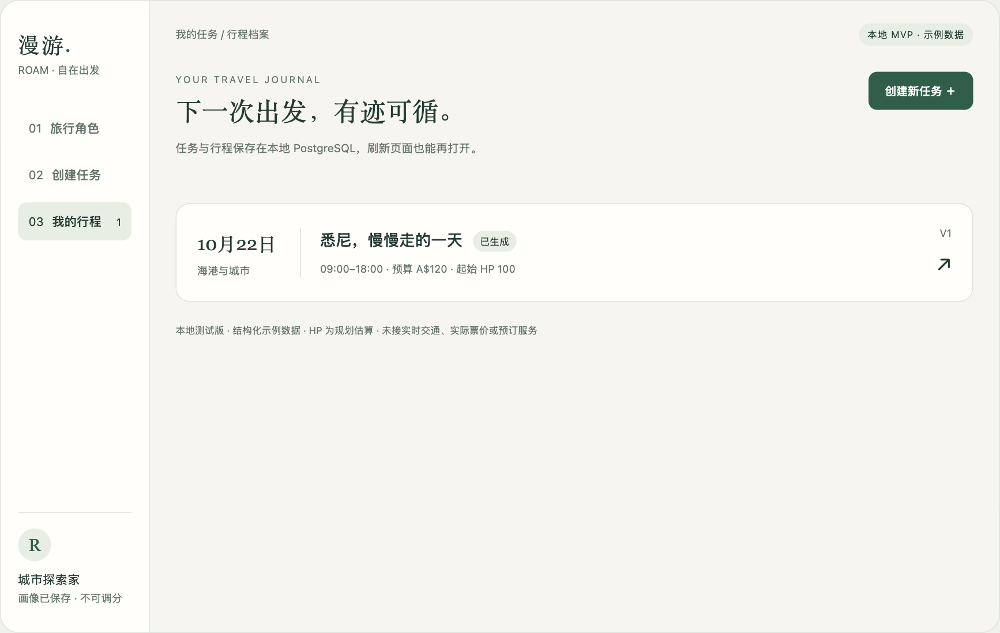

# hackathon · 漫游旅行规划 MVP

根据问答生成固定旅行画像，创建规划任务，获得考虑预算、时间和预计精力的完整行程。

[](https://github.com/f1sh11/hackathon/actions/workflows/ci.yml)

**React + TypeScript · ASP.NET Core .NET 10 · PostgreSQL 17 · Docker Compose**



## 本地运行

安装并启动 Docker Desktop，或其他支持 Docker Compose 的运行环境，然后：

```sh
git clone https://github.com/f1sh11/hackathon.git
cd hackathon
docker compose up --build --detach --wait
```

打开 **http://127.0.0.1:5080** 。首次构建需要联网下载依赖和基础镜像，应用本身不调用外部旅行、地图、模型或预订 API。

macOS / Linux 也可以运行 `./scripts/start.sh`；macOS 可双击 `启动漫游.command`。

可复制 `.env.example` 为 `.env` 自定义本地端口与开发数据库凭据。请在首次初始化之前设置数据库名称与密码；修改已经初始化的 PostgreSQL 卷的这些环境变量，不会自动重建数据库或变更现有账户密码。实际 `.env` 不提交。

服务只绑定 `127.0.0.1`，数据库端口不向宿主发布。默认凭据仅用于本地开发。

## 第一版功能

- 六个问题生成后端派生的固定画像；雷达图不能手动调分。
- 支持悉尼、单人、一日游；设置日期、预算、出发与返回时间、精力和主题。
- 纯 C# 规划器组合地点并校验开放时段、转场、返程、预算、步行与每一段 HP。
- 无可行解时显示冲突，不伪造成功行程。
- PostgreSQL 保存画像、任务和行程历史版本；支持生成轻松版。
- 相同请求编号重试不会重复创建任务或版本。

[查看行程页面示例](preview-itinerary.png) · [查看手机页面示例](preview-mobile.png)

## 数据与产品边界

地点、开放时段、费用、转场和 HP 全部为明确标记的示例数据，不能作为真实出行保证。日期随任务保存，暂不处理节假日差异。自由文本备注只保存，规划按结构化表单执行，不包含自然语言理解。

当前面向本地单个使用者，所有浏览器共享同一个固定画像。第一版不提供修改画像接口、账号体系、预订支付或媒体上传。

图片与视频适合存储于媒体目录或对象存储，PostgreSQL 保存元信息与关联；本版仅预留 `media_assets` 表。

## 停止与数据保存

```sh
docker compose down
```

数据库保存在 `postgres-data` 命名卷。停止、重建应用容器和再次启动不会清空数据。`down --volumes` 会删除该数据库卷，请勿用于保留数据的正常停止流程。

## 测试与 CI

安装 .NET 10 SDK 后运行核心测试：

```sh
dotnet run --project tests/Roam.Core.Tests --configuration Release
```

启动应用后，使用 Node.js 24 执行真实 HTTP 验收：

```sh
node scripts/smoke.mjs
```

该脚本会创建自动验收任务，不删除已有记录。纯 C# 测试覆盖 13 组情景，其中包括 160 个固定随机种子的约束案例。

GitHub Actions 会执行前端构建、.NET 规划器测试、后端构建、Docker Compose 启动、HTTP 验收，并明确对比容器重启前后的画像、任务 ID 与行程版本。[查看运行记录](https://github.com/f1sh11/hackathon/actions)

这是本地部署项目；没有配置线上服务器 CD，GitHub Pages 也不承担 .NET 和 PostgreSQL 的运行。

## 项目结构

```text
client/                   React + TypeScript 页面与锁文件
src/Roam.Api/             .NET API、PostgreSQL 存取、建表脚本
src/Roam.Core/            画像、纯 C# 规划器、示例地点
tests/Roam.Core.Tests/    无第三方测试框架依赖的核心测试
scripts/                 本地启动、HTTP 验收、持久化核验
compose.yaml             应用与 PostgreSQL
.github/workflows/       GitHub Actions 自动检查
```

## 非容器开发模式

需要 Node.js 24、pnpm 11.25.0、.NET 10 SDK 和独立的 PostgreSQL 数据库。

```sh
cd client
pnpm install --frozen-lockfile
pnpm build
cd ..
mkdir -p src/Roam.Api/wwwroot
cp -R client/dist/. src/Roam.Api/wwwroot/
export ConnectionStrings__Roam='Host=127.0.0.1;Port=5432;Database=roam;Username=roam;Password=YOUR_LOCAL_PASSWORD'
dotnet run --project src/Roam.Api --urls http://127.0.0.1:5080
```

也可使用 `pnpm dev`，开发代理将 `/api` 和 `/health` 转发到本地后端。

验收口径见 [docs/ACCEPTANCE.md](docs/ACCEPTANCE.md)，首次本地验证记录见 [docs/VERIFICATION.md](docs/VERIFICATION.md)。项目沿用仓库的 [MIT License](LICENSE)。
