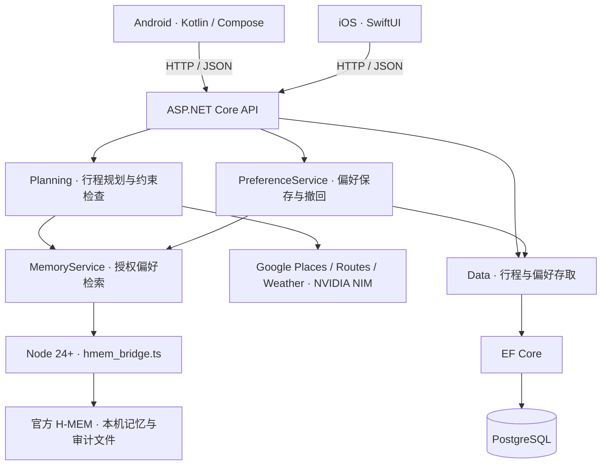

# Sydney Buddy · 悉尼旅行 Agent

**原生 iOS（SwiftUI）、Android（Kotlin + Jetpack Compose）与 ASP.NET Core（C# / .NET 10）后端，通过 EF Core 和 PostgreSQL 保存行程与偏好。** 单题引导收集旅行偏好，NVIDIA Nemotron 推荐候选地点，程序独立检查路线约束，再由用户确认保存。底图支持 OpenStreetMap / Apple / Google，在线地点、行程路线与天气可使用 Google Maps Platform，逐段步行导航采用 Ferrostar + Valhalla；授权偏好检索使用官方 Meterless H-MEM 引擎。

当前维护原生 iOS、Android 及其共用的 C# API。React 网页客户端与独立的旧版 React/.NET 原型已移除。Android 与保留的 SwiftUI iOS 客户端继续使用原接口、JSON 字段和 `8787` 端口。旧 Python 代码与 SQLite 文件保留供对照和回退；新后端不运行 Python，也不会自动导入旧 SQLite 数据。**当前仍为本机单用户原型，未部署线上服务，也未提交 HackOS。**

完整迁移范围与代码阅读说明见 [迁移说明](docs/ASPNET-MIGRATION.md)。

## 功能与边界

- 悉尼市区 1–3 天步行规划，8 个限定候选地标，每天最多 4 站，跨天不重复。
- Nemotron 只对已知地点 ID 排序；C# 代码独立检查预算、步数、营业时间、休息、衔接和返程。
- 调整先生成草案，用户确认后才保存。保存使用版本检查，冲突返回 HTTP `409`。
- 多行程管理、逐日天气刷新，以及需用户同意的偏好保存和撤回。
- Google Places 提供坐标与常规营业时段，Routes 提供步行路线，Weather 提供未来 10 天逐日预报。
- Android 原有引导、准备清单与整数分记账保留，准备进度与账本保存在设备本机。
- **旅行数字分身（World Model）**：对已确认行程生成追加式模拟快照，计算步行、预算、天气、交通四项风险，保存建议及用户“接受 / 保留原安排”的决定；不会静默重写行程。

## Meterless World Model：本次新增

World Model 对已保存行程做逐日规则检查，不是实时位置跟踪或真实世界预测。一个行程有一个稳定的 world；每次检查创建绑定 tripRevision 的 run，并把到站状态和用户决定追加到 PostgreSQL。iOS 在已有行程的 Koko 操作区提供“帮我检查”，不新增底部分页；Android 保持 main 原界面。

```text
已确认行程 → simulation run → 状态 snapshots → 风险 / 建议 → 用户接受或拒绝 → decision event
```

- PostgreSQL 表：`travel_worlds`、`world_runs`、`world_snapshots`、`world_events`。
- 迁移会在启动 API 时自动执行；因此只需先运行 `docker compose up -d db`，再启动 .NET API，不需要额外部署一个 World Model 容器。
- 风险按天计算，使用已保存路段时间、单日步数上限、归一化的 AUD/人/日活动预算及逐日预报；未知资料标为待确认。不会用固定比例伪造优化后数字。
- “看看怎么调整”衔接现有当天调整，“问 Koko 怎么确认”携带当天地点及未知字段衔接现有对话；真实路线重算、预览、保存及撤销沿用 main。记录接受建议不等于已经修改行程。
- 单次检查在 PostgreSQL 事务中完成；跨进程事务锁保证同 requestId 并发重试复用同一 run，失败整体回滚。行程版本变化后旧结果标为过期，不能继续采纳旧建议。

## 本机启动：PostgreSQL + .NET API

需要 **.NET 10 SDK**、**Node.js 24 或更新版本** 和 **Docker / Docker Compose**。Node 仅用于官方 Meterless H-MEM 引擎；HTTP API、规划与天气逻辑由 C# 运行。

在包含本次迁移的仓库根目录运行：

```sh
docker compose up -d db
```

Compose 的本机开发数据库为 `localhost:55432`，数据库名 `sydneybuddy`，用户名为 `sydneybuddy`，密码为 `sydneybuddy_dev`。这些值只适用于本机开发。按终端设置连接字符串，再启动 API：

**Windows PowerShell**

```powershell
$env:ConnectionStrings__SydneyBuddy = 'Host=localhost;Port=55432;Database=sydneybuddy;Username=sydneybuddy;Password=sydneybuddy_dev'
dotnet run --project server-dotnet/SydneyBuddy.Api
```

**macOS / Linux**

```sh
export ConnectionStrings__SydneyBuddy='Host=localhost;Port=55432;Database=sydneybuddy;Username=sydneybuddy;Password=sydneybuddy_dev'
dotnet run --project server-dotnet/SydneyBuddy.Api
```

首次运行会还原 NuGet 依赖，API 启动时使用 EF Core migrations 创建或更新 PostgreSQL 表。先关闭旧 Python 后端，避免争用 `8787` 端口。服务运行后打开 [健康检查](http://127.0.0.1:8787/health) 或 [本机密钥设置页](http://127.0.0.1:8787/setup)。每位成员使用自己的本机数据库；这仍是单用户开发模式。

也可通过启动脚本运行：Windows 使用 `powershell -File scripts/start-server.ps1`；macOS / Linux 使用 `sh scripts/start-server.sh`；macOS 也可双击 `scripts/start-server.command`。连接字符串仍需先设置在对应进程的环境中。

## Android（Windows / macOS）

额外需要 Android Studio、Android SDK 36、JDK 17 或 21，以及带 Google Play 服务的 Android 8.0+ 模拟器或手机。

1. 先按上文启动 PostgreSQL 和 .NET API。
2. Android Studio 打开 **`android/`**，等待 Gradle 同步。
3. 连接已开启 USB 调试的手机，或启动模拟器。
4. Windows 运行 `powershell -File scripts/connect-android.ps1`；macOS 运行 `sh scripts/connect-android.sh`，将设备端口转发到电脑。
5. 在 Android Studio 运行 `app`。不配置 Google 密钥即可使用默认 OSM 底图与演示行程；尚未查询道路路线时仅显示站点，不用直线替代导航路径。

每次重启模拟器或重新连接手机后，需要重做端口转发。若 `adb` 不在 PATH，连接脚本会尝试从 `ANDROID_HOME` 或默认 SDK 路径查找。命令行构建在 `android/` 中执行：

```sh
# macOS / Linux；Windows 使用 .\gradlew.bat
sh gradlew :app:assembleDebug :app:testDebugUnitTest :app:lintDebug
```

APK 输出为 `android/app/build/outputs/apk/debug/app-debug.apk`。真实 Google 底图需要单独的 Maps SDK for Android 密钥，写入被忽略的 `android/local.properties`：`MAPS_API_KEY=你的Android地图密钥`；保留 Android Studio 生成的 `sdk.dir`。iOS 地图密钥不通用，具体密钥限制由项目管理员管理。

Android 仍连接 `http://127.0.0.1:8787`。Debug 允许本机 HTTP，Release 禁止明文连接。独立联网 APK 需要 HTTPS 后端、客户端地址与身份认证；本次技术栈迁移不包含应用商店发布或云端部署。现有 [Android 验证记录](docs/ANDROID-VERIFICATION.md) 属于迁移前的历史证据。

## 保留的 iOS 客户端

需要 macOS、Xcode（iOS 17+ SDK/模拟器）、.NET 10 SDK 和 Node.js 24 或更新版本。先启动 PostgreSQL 和 .NET API，再打开 `ios/SydneyBuddy.xcodeproj`，运行 `SydneyBuddy` scheme。首次 Xcode 构建需联网下载 Google Maps SDK 与 Ferrostar 导航核心。

同机模拟器继续连接 `127.0.0.1:8787`；iPhone 真机不能用其自身的回环地址访问电脑。iOS 地图密钥更改后需要重新构建。原 [iOS 验证记录](docs/VERIFICATION.md) 是迁移前的历史记录，不能替代新版验证。

## 切换地图底图与免费开发模式

在 App 的 **“我的” → “地图底图”** 选择来源。新安装默认使用 OpenStreetMap，选择会保存在各自设备，重新打开 App 仍有效。地图切换不会调用 `/plan` 或保存 / 修改行程；镜头位置在本次 App 运行期间共用，新行程或不同日期会重新定位。

| 底图 | Android | iOS | 说明 |
|---|---|---|---|
| OpenStreetMap | MapLibre Native | MapKit + 替换底图的 `MKTileOverlay` | 无需 Google 金钥，需联网取得 OSM 图砖 |
| Apple Maps | 不提供 | 原生 MapKit | 使用 Apple 底图，需联网 |
| Google Maps | 原有 Maps SDK | 原有 Maps SDK | 需配置各自平台的地图金钥；缺少金钥会明确提示，不自动切换来源 |
| 离线示意图 | 支持 | 支持 | 不加载网络底图，只绘制示例位置和连线，不提供导航 |

OSM / Apple Maps 查询前仅显示景点标记；实际路线须由路线服务提供，缺少线形不补直线。`live` 行程含 Google Places / Routes 内容时，其他底图会隐藏整份地图图层并提示切回 Google；行程列表与原始数据仍保留，不把 Google 路径重新绘制到其他地图。参见 [Google Routes 政策](https://developers.google.com/maps/documentation/routes/policies)。

OSM 公共图砖只用于少量交互开发：请求包含 App 的 User-Agent，保留可见版权署名，遵守 HTTP 缓存，不提供预下载和离线区域下载。公共服务没有可用性保证，正式规模使用需评估其他图砖供应商或自架服务。图砖加载受网络影响时可选离线示意图。[OSM 使用政策](https://operations.osmfoundation.org/policies/tiles/)

### 后端付费服务开关

**底图来源和后端数据模式是两项独立设置。** 后端新增 `AllowPaidServices`，预设为 `false`：

- `demo` 规划仍可运行，保存 / 读取行程和本机 H-MEM 不受影响。
- `assisted`、`live` 规划及实时天气刷新会在调用外部服务前返回 `422`，即使已经配置服务端金钥。
- `/health` 回传 `paidServicesAllowed`；手机据此停用在线推荐开关。
- 这项保护针对后端 NVIDIA / Google HTTP 请求，不是地图 SDK、图砖网络或账户账单的总额度控制。

确实需要测试在线服务时，由后端开发者明确开启并重启服务，例如 macOS / Linux：

```sh
AllowPaidServices=true dotnet run --project server-dotnet/SydneyBuddy.Api
```

PowerShell 先运行 `$env:AllowPaidServices='true'` 再启动后端。仅在手机切换底图不会开启这项权限；测试结束后移除环境变量或设为 `false` 并重启。日常开发建议使用 **OSM + demo**；完全不加载网络底图时使用 **离线示意图 + demo**。

## 多站步行导航（开发测试）

地图首页点击 **“逐段步行导航”**。保持既有的行程顺序，包含起点、每个景点和最后返回点：

1. **预览整天步行路线**：一次请求经过所有停靠点的道路路线，仅供总览，不启动定位。
2. **开始本段导航**：从准确、近期的设备位置规划到下一站；显示路线、位置、转弯指示、距离与步行 ETA，支持英文系统语音及偏航重算。
3. **到站停留**：Ferrostar 判断到站后暂停，也可在导航中点“我已到达”手动确认。不会自动跳过景点；点“前往下一站”才继续。
4. **返回与完成**：最后一段回到当天终点，再确认完成。实际到站进度按设备、行程 ID / 版本和当天路线保存，不修改后端行程。
5. **模拟导航**：不读取设备 GPS，以 10 倍速度回放真实路线路径；模拟进度独立，不覆盖实际进度。模拟仍需联网计算路线，不是离线导航。

此版为**前台步行导航验证**：离开导航页、切到后台或锁屏会暂停定位和语音；回到页面后点开始，从当前位置重算本段。重开 App 保留已到站 / 已完成的路段，不自动恢复正在进行的导航。停留时间只显示提示，不计入步行 ETA。当前指引为英文，没有公交换乘、实时交通、景点顺序最佳化、后台持续导航或离线地图包。

`demo` / `assisted` 示例行程可以测试，景点和营业资料仍为示例；步行路线由 OSM / Valhalla 实际计算。含 Google Places 数据的 `live` 行程暂不进入开源导航，避免把受限制资料送到其他服务。开始真实导航前需在设备允许精确定位；实际起点和目的地会经后端送至已配置的路线服务。预览与模拟使用行程中的示例坐标。

### 配置步行路线服务

默认不配置路线服务，App 会提示尚未开启；**不会自动退回 Google 付费 Routes API**。后端环境变量必须指向可接受 Valhalla POST 请求并返回 OSRM 格式的 `/route` 端点：

```sh
# 自架 Valhalla 示例；该服务需要另行部署和导入 OSM 路网。
Navigation__ValhallaUrl=http://127.0.0.1:8002/route dotnet run --project server-dotnet/SydneyBuddy.Api
```

本次 Mac 测试遇到 .NET / 公共展示站 TLS 握手不相容，已提供可选的本机开发转接器，使用 Node 24 的正常 TLS 验证（未关闭证书检查）。若只想马上测试，另开一个终端运行：

```sh
node scripts/navigation-demo-proxy.mjs
```

接着以以上 `Navigation__ValhallaUrl=http://127.0.0.1:8002/route` 启动后端。这个脚本**不是自架 Valhalla**：仅监听 `127.0.0.1:8002`，只转接 `/route` 到固定公共展示站，最多同时 2 个请求，不保存坐标或日志；仍需联网、仍受公开服务可用性限制。只供少量手动开发测试，与自己的 Valhalla 服务二选一，不能用于营运或负载测试。一般 .NET 到自架服务能正常连接时，不需要这个脚本。

Windows PowerShell 先设置 `$env:Navigation__ValhallaUrl='http://127.0.0.1:8002/route'`。本机回环可用 HTTP，其他地址必须 HTTPS；后端不跟随重定向。`/health` 的 `navigationConfigured` 仅代表地址已配置，不保证上游在线。`POST /navigation/route` 接受 `locations: [{lat, lon}, ...]`，范围为 2–30 点；后端固定步行、OSRM、polyline6 和英文指引，客户端不能指定其他上游网址。

开发时可自行明确设置 `https://valhalla1.openstreetmap.de/route` 做少量交互测试；这是 [Valhalla 文档列出的公共演示服务](https://valhalla.github.io/valhalla/)，不是正式营运后端，不提供本项目的可用性或免费额度保证。上架前改为自架或有服务条款的托管服务。开源 SDK 无授权费用，但服务器、图砖与托管路线服务可能收费；`AllowPaidServices=false` 仅阻挡原有 NVIDIA / Google API，不是所有第三方账单的总开关。

### 导航架构与文件用途

```text
每日行程（起点 → 景点 → 返回点）
    └─ WalkingNavigator：当前路段、到站等待、下一站、本机进度、模拟隔离
        ├─ Ferrostar Core 0.59.0：指引、位置进度、语音触发、偏航重算
        │   └─ POST /navigation/route → ASP.NET Core → 配置的 Valhalla 服务
        └─ 中立坐标 / 路线 / 位置 → OSM、Apple MapKit 或 Google 地图画面
```

| 文件 | 用途 |
|---|---|
| `ios/SydneyBuddy/NavigationView.swift` | iOS 多段进度、Ferrostar 接入、模拟 / 真实定位、整天预览与 OSM / Apple / Google 导航画面 |
| `android/.../WalkingNavigation.kt` | Android 进度模型、Ferrostar 生命周期、权限、语音、预览与逐段导航操作 |
| `android/.../WalkingMap.kt` | 接收中立坐标的 OSM / Google 导航绘图，不拥有行程进度 |
| `server-dotnet/SydneyBuddy.Api/Services/NavigationService.cs` | 验证坐标、固定步行配置、请求 Valhalla、处理错误和取消 |
| `ios/SydneyBuddyTests/NavigationTests.swift` | iOS 进度、模拟隔离和真实 Ferrostar 路线回放测试 |
| `android/.../WalkingProgressTest.kt` | Android 多段顺序、返回段、无效进度与版本隔离测试 |
| `android/.../WalkingNavigationTest.kt` | Android 真正导航引擎回放、到站、暂停、错误与进度保存测试 |
| `android/.../WalkingNavigationUiTest.kt` | Android 预览、模拟、到站等待、下一站与行程不变的画面操作测试 |
| `android/.../WalkingLiveSmokeTest.kt` | 从真实首页进入，经配置的路线服务预览 / 导航 / 到站 / 下一站，临时测试行程在结束时清除 |
| `scripts/navigation-demo-proxy.mjs` | 可选的本机开发辅助，正常验证 TLS 后连接公共 Valhalla 展示站，不用于营运 |
| `tests/fixtures/walking-sydney.json` | 已记录的悉尼 OSM 路线，供两平台测试回放，无需测试时呼叫公开服务 |
| `server-dotnet/SydneyBuddy.Api.Tests/NavigationServiceTests.cs` | 后端输入验证、服务边界、多站顺序及上游错误测试 |

导航核心只接收当前路段，整天路线与到站进度由我们自己的 App 管理。此版本能切换的是**地图显示**，Google 底图仍需地图密钥，Apple 仅 iOS 提供；未接入 Google Navigation SDK，也没有把导航交给外部 Apple Maps。未来可新增独立导航实现，共用行程进度和开始 / 停止操作。

Android 为使用 Ferrostar 0.59.0，将构建工具对齐为 Kotlin 2.3.20、AGP 8.13.2、Gradle 8.13、compileSdk 36，JDK 仍为 17 / 21。iOS 只引入 `FerrostarCore`，继续复用原 MapKit / Google 绘图。SDK 为 Beta，版本固定，升级需重跑测试。

运行导航测试：

```sh
# 后端：需要本机 PostgreSQL；路由服务测试使用模拟 HTTP，不需路线金钥。
dotnet test server-dotnet/SydneyBuddy.Api.Tests
# Android：模拟器已连接，UI 测试需要运行配置导航端点的本机后端及 adb reverse。
cd android
# 常规检查排除使用真实路线服务的 LargeTest；其余导航回放使用录制数据。
sh gradlew :app:testDebugUnitTest :app:connectedDebugAndroidTest -Pandroid.testInstrumentationRunnerArguments.notAnnotation=androidx.test.filters.LargeTest
# 少量真实连线验证（需配置可用路由服务；不应放进高频 CI 或压力测试）：
sh gradlew :app:connectedDebugAndroidTest -Pandroid.testInstrumentationRunnerArguments.class=com.sydneybuddy.travel.WalkingLiveSmokeTest
# iOS：在 Xcode 选择 SydneyBuddy scheme 和 iPhone 模拟器后运行 Product > Test。
```

## 配置

仓库只提供配置模板，不包含可用服务密钥。服务端读取仓库根目录 `.secrets.json` 或同名环境变量，环境变量优先；不会自动加载 `.env`。Node H-MEM 数据继续保存在 `server/.hmem/`。

| 配置项 | 用途 |
|---|---|
| `ConnectionStrings__SydneyBuddy` | PostgreSQL 连接字符串 |
| `NVIDIA_API_KEY` | 服务端调用 NVIDIA NIM，不进入 Android APK 或 iOS App |
| `NVIDIA_MODEL` | 默认 `nvidia/nemotron-3.5-lightning-30b-a3b` |
| `GOOGLE_SERVER_KEY` | 服务端 Places API (New)、Routes API、Weather API |
| `GOOGLE_IOS_KEY` | 保留的 iOS 客户端地图 SDK 配置 |
| Android `MAPS_API_KEY` | 仅写入 `android/local.properties` 的 Android 地图 SDK 密钥 |
| `Navigation__ValhallaUrl` | 可选，步行导航路由服务地址；默认未开启，配置后重启后端 |
| `NODE_BINARY` | 可选，Node 24 或更新版本可执行文件路径；默认从 PATH 查找 |
| `SYDNEYBUDDY_ROOT` | 可选，仓库根目录绝对路径，自动定位失败时设置 |

API 密钥也可通过本机 `/setup` 页面保存。模板见 [.secrets.example.json](.secrets.example.json) 和 [Secrets.example.xcconfig](ios/Config/Secrets.example.xcconfig)。单独设置 iOS 环境变量不会自动生成客户端构建配置；应通过设置页或手动填写 xcconfig。

Google 项目需要启用计费及对应服务。地图 SDK 与服务端 API 分别配置。`/health` 显示已配置，不代表模型、地图、路线或天气真实调用成功；费用参考 [Google 官方价格](https://developers.google.com/maps/billing-and-pricing/pricing)。

## 模式和天气

| 模式 | 模型 | 其他数据 |
|---|---|---|
| `demo` | 本地规则，不调用 AI | 示例地点、天气、营业时段与距离估算 |
| `assisted` | 真实 Nemotron | 示例地点、天气和路线，不请求 Google 服务端 API |
| `live` | 真实 Nemotron | Google Places、Routes、Weather；花费、场内步数与停留时间仍为估算 |

天气按悉尼旅行日期逐日匹配，并分别影响当天室内/室外筛选。Weather 请求未来 10 天、`pageSize=10`，超时 8 秒；失败或超出范围时明确显示未知。独立刷新天气不会重排已保存行程，调整仍需生成并确认草案。雨天快捷情景明确标注为用户指定，不能当成实时天气证据。

## API 兼容性

本机服务仍使用 `127.0.0.1:8787`，无账户系统，保留本机来源检查。JSON 请求使用 `Content-Type: application/json`。

| 方法 / 路径 | 说明 |
|---|---|
| `GET /health` | 服务状态与配置是否存在，不返回密钥 |
| `GET /catalog` | 8 个候选地点的示例基础数据 |
| `POST /plan` | 按 profile 和 mode 生成草案，不保存 |
| `POST /weather` | 刷新天气，不保存或重排行程 |
| `GET /trips` | 已保存行程 |
| `POST /trips` | `{ "trip": <草案>, "expectedRevision": 0 }`；修改时传当前 revision |
| `DELETE /trips/{id}` | 删除指定行程 |
| `GET /trips/{id}/world` | 读取该行程最新的 World Model 模拟投影 |
| `POST /trips/{id}/simulation-runs` | `{ "requestId": "可重试的客户端编号" }`，创建或重取一次模拟 |
| `GET /simulation-runs/{id}` | 读取模拟状态、快照、建议和决定 |
| `POST /simulation-runs/{id}/decisions` | `{ "suggestionId": "…", "decision": "accepted\|rejected" }`，追加用户选择 |
| `GET /memories` | 已保存的授权偏好 |
| `POST /memories` | `{ "consent": true, "summary": "喜欢艺术", "profile": {"interests":["艺术"],"maxSteps":5000} }` |
| `DELETE /memories/{id}` | 从可检索记忆撤回，保留追加审计历史 |
| `GET/POST /setup` | 本机配置页，提交需要页面提供的 CSRF 令牌 |

Android / iOS 使用上述接口。服务不再托管 React 静态文件或注册旧网页的 `/api` 别名；根路径 `/` 返回 JSON 404，本机配置仍从 `/setup` 进入。约束无可行解为 `422`，保存版本冲突为 `409`，非法来源为 `403`。API 不执行订票、付款或赛事提交。

## 测试与 CI

```sh
dotnet restore server-dotnet/SydneyBuddy.Api.Tests/SydneyBuddy.Api.Tests.csproj
dotnet build server-dotnet/SydneyBuddy.Api.Tests/SydneyBuddy.Api.Tests.csproj --no-restore
dotnet test server-dotnet/SydneyBuddy.Api.Tests/SydneyBuddy.Api.Tests.csproj --no-build
# macOS / Linux：官方 H-MEM conformance
HMEM_IMPL="$PWD/server/vendor/hmem/src/index.ts" \
  node server/vendor/hmem/conformance/runner.ts
```

后端集成测试在上述 PostgreSQL 连接中创建专属随机 schema，完成后清理；连接用户需要创建 schema 的权限。详细说明见 [迁移说明](docs/ASPNET-MIGRATION.md)。GitHub Actions 启动 PostgreSQL 服务，使用 .NET 10 构建与测试，运行 H-MEM 检查。Android 继续使用原构建工作流。自动测试不调用付费 API。迁移后的测试结果以当前 CI 和迁移说明为准；原 Python / Android / iOS 版本的成功记录不能直接作为新版在线或真机验收结果。

## 项目结构

| 路径 | 职责 |
|---|---|
| `android/` | Kotlin / Jetpack Compose Android 客户端 |
| `ios/` | 保留的 SwiftUI 客户端 |
| `server-dotnet/SydneyBuddy.Api/` | ASP.NET Core REST API、C# 规划、天气、依赖注入、EF Core / PostgreSQL 存储 |
| `server-dotnet/SydneyBuddy.Api.Tests/` | 新后端的单元与 HTTP 兼容性测试 |
| `server/places.json` | 沿用的候选地点基础数据 |
| `server/hmem_bridge.ts`、`server/vendor/hmem/` | 由 C# 调用的官方 H-MEM 引擎与许可 |
| `server/.hmem/` | 本机记忆与审计数据，Git 忽略目录 |
| `server/*.py`、`server/tests/` | 旧 Python 实现和对照测试，不参与新后端运行 |
| `compose.yaml` | 本机 PostgreSQL 开发服务 |

## 程序架构与数据流

手机 App 负责界面、交互和设备本机状态；ASP.NET Core 负责规划规则、外部服务调用和数据库。两端通过 HTTP / JSON 沟通，手机不会直接连接 PostgreSQL。开发时后端运行在电脑上；未来可部署到服务器，再将手机的 API 地址改为 HTTPS 服务地址，无需把后端放进手机。



Google 地图底图由 Android / iOS 各自的 Maps SDK 显示；后端的 Places、Routes 和 Weather 则提供地点、路线和天气资料。手机地图 SDK 使用各自平台的地图密钥，NVIDIA 与 Google 服务端密钥留在后端。

一次行程操作分为两阶段：

1. **生成草案**：手机收集偏好 → `POST /plan` → 验证输入 → 收集地点、天气和推荐 → 检查整条路线 → 返回草案。此时不保存行程。
2. **确认保存**：用户确认 → `POST /trips`，传入草案及 `expectedRevision` → 检查行程结构和版本 → 写入 PostgreSQL。旧版本提交返回 `409`，手机需要刷新后再调整。

| 数据 | 保存位置 | 负责部分 |
|---|---|---|
| 已确认行程、revision、授权偏好摘要 | PostgreSQL | C# Repository / EF Core |
| World Model world、模拟 runs、状态快照、用户决定 | PostgreSQL | `WorldRepository` / `TravelWorldModelService` |
| 偏好检索内容与追加审计记录 | `server/.hmem/` | 官方 H-MEM，经 C# 调用 Node |
| 默认旅行偏好、准备进度、记账 | 各自手机的本机存储 | Android `BuddyStore`、iOS `AppStore` |
| 服务端配置与密钥 | 环境变量或被 Git 忽略的 `.secrets.json` | `SecretStore` |

设备本机数据目前不跨手机同步。PostgreSQL 偏好摘要与 H-MEM 是两个存储，`PreferenceService` 协调它们；数据库保存失败时尝试撤回刚添加的记忆，不是跨存储事务。

## 主要文件用途

### Android 前端

以下 Kotlin 文件都位于 `android/app/src/main/java/com/sydneybuddy/travel/`。

| 文件 | 用途与常见修改场景 |
|---|---|
| `MainActivity.kt` | App 入口、主画面切换，以及草案、行程列表、AI 调整、记账和设置画面；修改主流程时从这里看起 |
| `IosStyle.kt` | Android 的 iOS 风格首页、8 步引导、日历、导航及共用视觉元件；这是 Kotlin Android 文件，不是 iOS 代码 |
| `BuddyStore.kt` | ViewModel 状态、HTTP 请求、草案与行程操作、天气和偏好操作、本机资料保存；也是 Android 后端地址的设置位置 |
| `Domain.kt` | 旅行偏好与起终点模型、JSON 转换、输入检查、整数分金额与均分、保存载荷、路线 polyline 解码 |
| `RouteMap.kt` | 统一底图入口、Google / 离线示意图，以及 Google 内容的图层隔离 |
| `WalkingRouteDots.kt` | 沿實際道路幾何產生步行小圓點，依縮放調整間距，避免和底圖步道混淆 |
| `MapProvider.kt` | 底图选项、共用镜头状态、OSM / MapLibre 显示及图砖请求识别和缓存 |

| 配置 / 测试文件 | 用途 |
|---|---|
| `android/app/build.gradle.kts` | SDK、App 版本、依赖、地图金钥引用与测试依赖 |
| `android/app/src/main/AndroidManifest.xml` | 入口 Activity、网络权限、地图 SDK 与安全设置 |
| `android/app/src/main/res/` | 图示、系统主题、备份与网络安全规则；`src/debug/res/` 覆盖本机开发网络规则 |
| `android/app/src/test/java/com/sydneybuddy/travel/DomainTest.kt` | 金额、模型、版本保存与路线解码的单元测试 |
| `android/app/src/androidTest/java/com/sydneybuddy/travel/BuddyFlowTest.kt` | 在模拟器 / 装置操作引导、保存、取消调整、准备清单与记账流程；需后端和端口转发 |

### iOS 前端

Swift 文件位于 `ios/SydneyBuddy/`。`Models.swift` 同时包含数据模型和 `AppStore`，不只是类型声明。

| 文件 | 用途与常见修改场景 |
|---|---|
| `SydneyBuddyApp.swift` | App 入口、根画面、8 步引导，以及 Buddy 角色、颜色和共用按钮 |
| `Models.swift` | API 数据模型、`AppStore` 状态管理、网络请求、草案与保存流程、本机存储；也是 iOS 后端地址的设置位置 |
| `MapView.swift` | 首页、底图统一入口、OSM / Apple / Google 实作、镜头状态与离线示意图 |
| `TripViews.swift` | 行程草案、确认保存、AI 调整、行程列表、天气与出发准备画面 |
| `SettingsViews.swift` | 记账、设置，以及需要同意的偏好保存与撤回画面 |
| `ios/Config/Base.xcconfig`、`Secrets.example.xcconfig`、`Info.plist` | 建置设置、本机地图金钥范本与 App 配置，实际配置目录为 `ios/Config/` |
| `ios/SydneyBuddy.xcodeproj/project.pbxproj` | Xcode 工程、来源文件、建置目标与 Google Maps 套件设置 |

### ASP.NET Core 共用后端

后端按用途分层，目录如下。表中的路径相对于 `server-dotnet/SydneyBuddy.Api/`。

```text
server-dotnet/
├── SydneyBuddy.Api/
│   ├── Program.cs          启动、依赖注册、数据库迁移与路由
│   ├── Api/                HTTP 请求与响应边界
│   ├── Planning/           行程业务规则与调度
│   ├── Services/           天气、外部请求和记忆整合
│   ├── Data/               EF Core 模型、数据库迁移和存取
│   └── Infrastructure/     配置、资源路径及共用工具
└── SydneyBuddy.Api.Tests/  后端单元与整合测试
```

| 文件 | 用途 |
|---|---|
| `Program.cs` | 设置端口与请求限制，注册服务，启动时应用数据库迁移，并挂上手机 API |
| `Api/ApiEndpoints.cs` | 组合规划、行程、偏好与设置的路由模块 |
| `Api/PlanningEndpoints.cs` | 健康状态、景点目录、生成草案与天气接口 |
| `Api/TripEndpoints.cs` | 已保存行程的查询、保存、删除及版本冲突响应 |
| `Api/MemoryEndpoints.cs` | 授权偏好的查询、保存和撤回接口 |
| `Api/SettingsEndpoints.cs`、`SetupPage.cs` | 本机 `/setup` 配置表单及 CSRF 检查；不是 React 网页客户端 |
| `Api/RequestJson.cs`、`TripContractValidator.cs` | 读取 JSON 请求，以及检查保存草案的数据结构 |
| `Api/LocalRequestMiddleware.cs` | 本机访问限制、响应头、统一错误处理与请求日志 |
| `Planning/Planner.cs` | 编排输入验证、地点、天气、推荐和调度，返回未保存草案 |
| `Planning/PlanValidator.cs` | 检查并补全日期、天数、预算、步数、时间与起终点 |
| `Planning/PlaceCatalog.cs`、`CatalogCache.cs` | 读取及缓存本机景点目录；不缓存私人偏好或实时天气 |
| `Planning/PlaceService.cs` | 取得示例或 Google Places 候选地点 |
| `Planning/RecommendationService.cs` | 检索授权偏好，并在在线模式调用 Nemotron 对已知地点排序 |
| `Planning/RouteService.cs` | Google 步行路线查询、演示距离估算与本次规划内的路段复用 |
| `Planning/RouteScheduler.cs` | 安排多日景点顺序，检查营业窗口、转场、休息、预算、步数和返程 |
| `Planning/PlanningContext.cs` | 单次规划的模式、配置快照、证据记录与路段缓存 |
| `Services/WeatherService.cs` | 天气查询、逐日匹配，以及范围外或查不到资料的处理 |
| `Services/ExternalJsonClient.cs` | 外部 HTTP / JSON 请求、超时和提供商错误处理 |
| `Services/MemoryService.cs` | 管理 Node 子进程，调用 H-MEM，控制并发和超时 |
| `Services/PreferenceService.cs` | 协调 H-MEM 与 PostgreSQL 的偏好摘要保存和撤回 |
| `Data/BuddyDbContext.cs` | EF Core 实体、表与 JSONB 字段映射 |
| `Data/TripEntity.cs`、`MemoryEntity.cs` | 行程与授权偏好摘要的数据库实体 |
| `Data/TripRepository.cs` | 行程查询、保存、删除与原子 revision 检查 |
| `Data/MemoryRepository.cs` | 授权偏好摘要的数据库存取 |
| `Data/Migrations/` | 数据库结构变更及模型快照；修改表结构时维护迁移 |
| `Infrastructure/DependencyInjection.cs` | 集中注册服务与生命周期；DbContext / Repository 随请求建立 |
| `Infrastructure/PaidServicePolicy.cs` | 后端付费请求的明确启用策略，预设拒绝 |
| `Infrastructure/ProjectPaths.cs` | 定位仓库、景点资料、密钥及 H-MEM 目录 |
| `Infrastructure/SecretStore.cs` | 读取环境变量 / 私有配置，保存本机配置及 iOS 地图设置 |
| `Infrastructure/JsonExtensions.cs`、`ServiceException.cs` | JSON 字段读取工具与业务错误类型 |
| `SydneyBuddy.Api.csproj` | .NET 目标版本、EF Core 和 PostgreSQL 依赖 |

### 共享资料、工具与历史代码

| 路径 | 用途 |
|---|---|
| `server/places.json` | 当前 C# 后端仍在读取的景点基础资料 |
| `server/hmem_bridge.ts` | 将 C# 的记忆操作转交给官方引擎；删除 React 后仍需保留 |
| `server/vendor/hmem/` | 第三方记忆引擎、相容性测试、来源与独立许可，通常不直接改动 |
| `server/*.py`、`server/requirements.txt`、`server/tests/` | 历史 Python 后端和对照测试；当前启动脚本与 .NET API 不使用它们 |
| `scripts/start-server.sh`、`.command`、`.ps1` | 各平台的 .NET 后端启动入口 |
| `scripts/connect-android.sh`、`.ps1` | Android 装置到电脑后端的 `adb reverse` 端口转发 |
| `scripts/generate_project.py` | 重新产生 iOS Xcode 工程与 Info.plist 的辅助工具，日常启动不需执行 |
| `compose.yaml` | 本机 PostgreSQL 容器、端口、健康检查与持久化 volume |
| `global.json` | .NET SDK 版本选择规则 |
| `.secrets.example.json` | 服务端配置范本；实际 `.secrets.json` 不提交 Git |
| `.github/workflows/ci.yml` | PostgreSQL、.NET 后端测试与官方 H-MEM 检查 |
| `.github/workflows/android.yml` | Android APK 建置、领域测试及静态检查 |
| `docs/` | 迁移说明、历史验证记录、截图、演示与参赛清单 |

## 团队分工与建议阅读顺序

| 小组 / 工作 | 主要修改位置 | 需要共同约定的事项 |
|---|---|---|
| Android 前端 | Kotlin 画面、`BuddyStore.kt`、`Domain.kt` | API JSON、错误码、载入与保存状态 |
| iOS 前端 | SwiftUI 画面、`Models.swift` 中的 `AppStore` | 与 Android 一致的业务流程和 API 契约 |
| 后端业务 | `Api/`、`Planning/`、`Services/` | 字段含义、可行性规则、失败情境 |
| 数据库与整合 | `Data/`、`Infrastructure/`、Compose | 迁移、配置、版本冲突与资料边界 |

前后端保留在同一个仓库即可独立分工。修改 API 字段时同时核对 Android 的 JSON 转换、iOS 的 Codable 模型及后端 HTTP 测试；修改业务约束时优先从后端规划层处理。Android 的画面和 iOS 的模型 / 状态管理目前集中在少数文件，同组多人同时修改时应先约定负责范围。

第一次接手建议依序阅读：

1. **画面入口**：Android `MainActivity.kt` / `IosStyle.kt`，或 iOS `SydneyBuddyApp.swift`，了解用户流程。
2. **请求与状态**：Android `BuddyStore.kt`，或 iOS `Models.swift`，追踪产生草案和确认保存。
3. **HTTP 边界**：`PlanningEndpoints.cs` / `TripEndpoints.cs`，了解请求如何进入后端。
4. **业务规则**：`Planner.cs` → `PlanValidator.cs` → `RouteScheduler.cs`，理解模型推荐与程序验证的分工。
5. **持久化**：`TripRepository.cs` → `BuddyDbContext.cs`，理解确认保存和 revision 冲突。
6. **验证**：阅读 `SydneyBuddy.Api.Tests/` 与 Android 的测试，了解已有案例和环境需求。

## 限制与黑客松状态

- 限定 8 个悉尼地标、步行模式，每天最多尝试 8 个初筛候选顺序，不保证全局最优。Google 常规营业时段可能不适用于节假日。
- 花费、步数和停留时间为估算；没有住宿、全部餐饮、实时票价、排队、坡度或无障碍模型。
- 没有多人账户、共享同步、支付、订票、酒店预订、航班追踪或后台 GPS。PostgreSQL 支持存储，并不自动提供用户隔离或云端同步。
- H-MEM 为本机单用户，撤回后不再检索，但审计历史保留；未启用自动 dreaming / sleep。
- 原 Python 版本有 NVIDIA NIM 和 H-MEM 验证记录；迁移后的真实在线功能需使用本机配置重新验收。Cursor、Nightshift 未接入；Zetaris 已完成本機公開資料整合試驗；不声称满足全部赛事要求。见 [参赛清单](docs/submission-checklist.md)。
- `docs/` 中既有截图与视频描述迁移前版本；当前原生客户端与 .NET 后端以代码和测试结果为准。

## 来源与许可

项目沿用 [MIT 许可证](LICENSE)。`server/vendor/hmem` 保留官方参考实现的 Apache-2.0 许可和 [来源说明](server/vendor/hmem/UPSTREAM.md)。Google SDK 及在线服务受各自条款约束。

[Google Maps iOS](https://developers.google.com/maps/documentation/ios-sdk/config) · [Places](https://developers.google.com/maps/documentation/places/web-service/text-search) · [Routes](https://developers.google.com/maps/documentation/routes/compute_route_directions) · [Weather](https://developers.google.com/maps/documentation/weather/overview) · [NVIDIA NIM](https://docs.api.nvidia.com/nim/reference/llm-apis) · [Meterless](https://github.com/Meterless/Meterless/tree/main/engines/hmem)

交互借鉴 Duolingo 的小步学习、即时反馈与完成奖励，使用原创 Buddy 角色；本项目与 Duolingo 无关联。

### 首頁行程地圖（本地開發分支）

首頁的站點標記固定顯示「起、1、2…終」，綠色順序連線與箭頭串起全天行程；20 公尺內的景點共用 `3/4` 這類標記，點按可查看各站名稱與時間，避免圖釘互相遮住。環狀行程的起點與返回點共用「起/終」標記。底部站點列可水平捲動。

- **展開地圖**：全螢幕查看整天順序，關閉後保留首頁視角。
- **顯示步行路線**：按下後才呼叫既有 `/navigation/route`；成功後以沿道路的路線取代順序示意，顯示總距離、步行時間與各段時間（不含景點停留）。失敗時保留順序示意並可重試。
- 切換底圖不會自動呼叫規劃服務。示例／assisted 行程可使用 OSM 步行預覽；Google live 行程保留原本的來源限制，不送入開源路線服務。OSM／Apple 的首頁不使用 Google 路線資料。
- 預覽不取得裝置定位、不啟動語音或導航、不修改已儲存行程或導航進度。離線示意圖持續只顯示順序示意。

主要檔案：`ios/SydneyBuddy/ItineraryOverview.swift`、`android/.../ItineraryOverview.kt` 管理預覽請求、polyline6 解析與編號標記；既有 `MapView.swift`／`MapProvider.kt`／`RouteMap.kt` 負責各底圖的圖層呈現。

### 開放交通資料與多模式規劃

首頁新增「交通路线规划」：參考地圖 App 的起終點摘要與可收合路線面板，支援整體／逐段選擇步行、開車或大眾運輸，以及指定悉尼當地出發時間。公車步驟包含路線號碼、方向、上下車站、候車時間、站數與站台（資料有提供時）；地圖按交通方式分色，步行顯示點線。

底圖與路線來源分離，切換底圖後預選對應服務，需手動按查詢才發送請求：

- **OSM**：Valhalla 步行／開車，OpenTripPlanner 2.10 + GTFS 公交；測試不需 Google。
- **NSW + Valhalla**：可在面板另選，公交直接接官方 Trip Planner API，服務端設定 `TFNSW_API_KEY`，不用自行部署 OTP。
- **Google**：Google Routes 道路／公交；只可顯示在 Google 底圖，須服務端金鑰與付費開關，預設仍禁用。
- **Apple（iOS）**：MKDirections 原生步行／開車。MapKit 不提供 App 內完整公交線形和班次明細；可另選 NSW／開源，或開啟 Apple Maps 查首個公交區間。

iOS 的首頁與全天地圖共用交通面板的成功規劃結果；Apple / OSM 示例行程展開全天地圖時，若尚無路徑，會查詢對應步行服務，並提供查詢／重試入口。

共用 `JourneyPlan → legs → steps → geometry`，每段獨立畫線：步行藍色密集小圓點虛線、大眾運輸藍色細實線（含 Metro / Train）、開車綠色細實線、藍色起點、空心編號站點、紅色終點及上下車圓點。路線來自服務回傳的道路线形，未查詢或缺少線形時不畫站點直線。切換來源清空舊結果，不自動退回其他供應商。既有 Ferrostar 逐段導航目前限定 OSM / open 步行。

**目前尚未設定 NSW 金鑰或部署 OTP，真實公交班次尚未啟用。** Apple 原生步行路線已實際查詢驗證；Google／NSW 轉接器已完成本地契約測試，尚未使用真實金鑰連線。 本地測試使用明確標示的 `TEST-01` 合成資料，正式畫面不會自行產生測試公車。設定方式、資料來源、API 與驗證限制見 [開放交通串接說明](docs/OPEN-TRANSIT.md)。

### 客製化多日時間軸（本機原型）

既有問答頁面保留。demo 草案現在提供直向時間軸，可拖動活動、拉下緣調整停留、勾選景點與必去、跨日移動及還原；同時重算每日步數、花費與「交通＋景點排隊」額度。支援多日生活安排的示例：住宿、餐飲、廁所、寄放與取件，含營業／時段衝突檢查及確認保存。

入口為「行程 → 試用 3 天時間軸」，或已保存 demo 行程的「編輯時間軸」。住宿／設施為待確認佔位、排隊未知、交通為估算；這版不聲稱已取得真實設施、房價、排隊或即時天氣資料。完整功能、API、檔案與限制見 [時間軸說明](docs/SCHEDULE-EDITOR.md)，產品目標見 [修改規劃書](docs/PERSONALIZED-TRAVEL-PLAN.md)。

行程編輯器目前提供左右分欄景點工具箱、拖放指定時段、右側固定日期列與景點介紹；地圖首頁依底圖選擇地點搜尋：OSM 預設使用本機 Overture Places 快照，iOS Apple Maps 使用原生 MapKit，Google Maps 使用 Google Places（需設定及允許付費服務，手動查詢）。Overture／OSM／Apple 地點可收藏至工具箱；Google 結果目前限搜尋畫面，不匯入本機示例時間軸。搜尋來源、公共服務限制與開發位置見 [開源地點搜尋說明](docs/POI-SEARCH.md)。

### 介面語言與首頁

- iOS 底部分頁為「行程、探索、我的」，記帳及 Koko 行程檢查整合在旅行工作台；Android 保留 main 原有分頁，開啟 App 預設先顯示行程列表；選擇行程的「查看地圖」可帶入該行程。新行程確認儲存後仍可進入地圖。
- 在「我的 → 語言」選擇繁體中文、簡體中文或 English，立即套用並保存在裝置；不改變已儲存行程或重新呼叫規劃服務。預設使用繁體中文。
- 目前翻譯涵蓋主要導覽、設定頁、行程列表、地圖常用操作與交通摘要；尚未收錄的細部文案、後端回傳內容、使用者輸入及景點名稱保留原文。地圖圖磚與第三方導航提示的語言由資料來源決定。
- 共用翻譯來源為 `shared/localization/ui.json`。編輯後執行 `python3 scripts/generate_localizations.py`，產生 iOS `.strings` 與 Android 資源；新增 Swift 檔案或重建專案時執行 `python3 scripts/generate_project.py`。

### 開源商家搜尋改用 Overture

OpenStreetMap 底圖的商家／景點搜尋預設改讀取本機 Overture Places，避免公共 Overpass 連線失敗。目前已下載雪梨市中心 5,968 筆真實地點；名稱搜尋、分類、附近距離、電話／地址／網站及工具箱匯入已接上。資料是 `2026-10-21.0` 的區域快照，不代表即時營業或已驗證座標。

資料檔不放進 Git；新機器請依 [Overture 匯入與設定](infra/poi/README.md) 執行 `scripts/import_overture_places.py`。Apple Maps 仍用 Apple 搜尋，Google Maps 仍需原本的服務設定。

## iOS 宠物对话（本分支）

新增宠物首次引导、文字 AI 对话/点选回答切换、旅行草稿恢复和长期偏好确认管理。仅 iOS 界面更新，Android 保持原版。详见 [使用与记忆说明](docs/PET-CHAT-IOS.md)。


### Zetaris 本機資料整合試驗

本機公開資料來源與資料匯出／驗證工具請見 [infra/zetaris/README.md](infra/zetaris/README.md)。真正 Zetaris 已在本機啟動，五張公開旅遊資料 view 已註冊並通過 JDBC 查詢驗證；iOS／Android 可在「我的 → 旅遊資料來源」切換直接來源或 Zetaris，支援商家、候選景點目錄、私房景點、即時天氣與底圖設定。天氣由 Zetaris 原生 REST 表每次呼叫 Open-Meteo，不保存預報快照；社群景點包保存座標、到達介紹及逐張照片來源／授權，尚無旅客評論資料。底圖渲染與導航仍由既有服務提供。查詢快取及重啟步驟見該說明。

地圖搜尋已整合「全部、景點、私房景點、餐飲、住宿、店家、生活設施」，Zetaris 模式合併 Overture／OSM／Wikivoyage，地圖標記與清單來自同一組結果，可看介紹及加入工具箱。OSM 另有 5,318 筆公開資料（含 207 筆住宿與 1,992 筆店家），更新與測試見上述 Zetaris 說明。

### Zetaris 搬到 AWS

公開資料的一鍵打包、校驗及 AWS 匯入步驟，請看 [Zetaris 搬移工具](infra/zetaris/migration/README.md)。

Zetaris 平台的本機安裝／快速啟動、AWS managed cluster 建立及停止方式，請看 [服務啟動教學](infra/zetaris/migration/SERVICE-STARTUP.md)。
