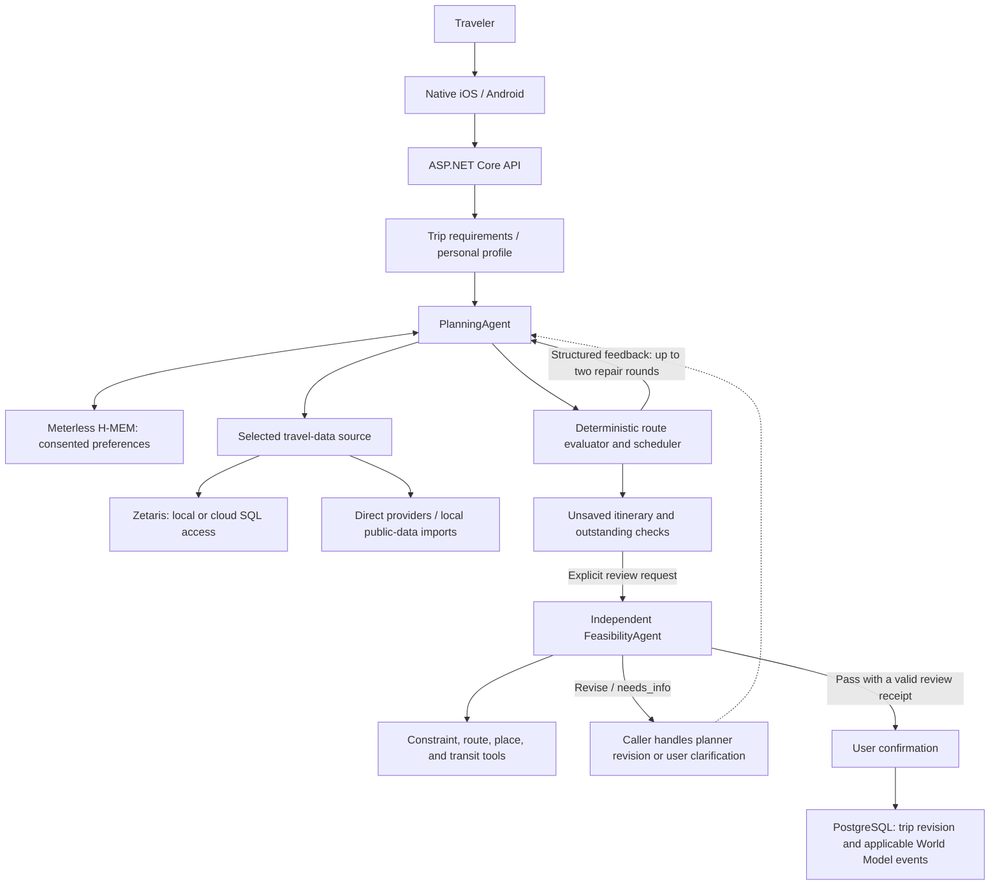

# Sydney Buddy

> **Track:** Solving Fragmented Intelligence
>
> **Purpose:** Turn scattered travel information and confirmed user preferences into a constrained, explainable Sydney itinerary.
>
> **Core integrations:** Zetaris data access, Meterless H-MEM, NVIDIA Nemotron; an optional Meterless Runtime planning provider.
>
> **Run:** PostgreSQL + `dotnet run --project server-dotnet/SydneyBuddy.Api`; the local API listens on `127.0.0.1:8787`.

## 1. Problem

A traveler must combine places, opening windows, weather, walking routes, public transport, budget, and preferences before deciding what fits into a day. These facts come from different systems, with different identifiers, freshness, and certainty.

Sydney Buddy integrates those inputs into an itinerary with stops, timing, estimated costs, sources, and unresolved checks. The model proposes activities; application code checks hard constraints; an independent reviewer can request changes or evidence.

For **Solving Fragmented Intelligence**, the contribution is connecting fragmented evidence to a validated decision, while keeping conflicting or unknown facts visible.

## 2. Agents and Responsibilities

| Component | Responsibility | Authority and feedback |
| --- | --- | --- |
| Trip conversation (`PetConversation`, `ProfilingDialogue`) | Collect and clarify the current trip's requirements through Koko, the travel companion. | Keeps incomplete requirements explicit rather than silently filling important gaps. |
| `PersonalProfileAgent` | Collect reusable travel preferences in a separate conversation. | Long-term preference storage requires user consent; current trip facts take priority over recalled preferences. |
| `PlanningAgent` | Rank known candidates and, in skill-based modes, propose daily allocations and unbooked accommodation suggestions. | Revises choices or ordering in response to evaluator feedback; cannot invent candidate IDs or relax hard constraints. |
| `FeasibilityAgent` | Independently review a structured draft using route, place, and transit evidence. | Returns `pass`, `revise`, `needs_info`, or `unavailable`; a completed model review and valid evidence are required for approval. |
| Route evaluator, scheduler, and policy guards | Calculate time, cost, steps, required visits, and evidence consistency. | Deterministic services, not additional LLM agents. Their blocking findings cannot be overridden by model prose. |

## 3. Architecture and Collaboration



Two feedback mechanisms are implemented:

- **Planning loop:** `PlanningCollaboration` evaluates the model's proposal and sends structured issues back for up to two repairs. If that cannot produce an accepted proposal, the bounded rule-based optimizer may attempt a schedule under the same hard constraints. Its result is recorded as a deterministic fallback.
- **Independent review:** `FeasibilityAgent` has its own role, context, read-only tool-selection loop, and decision. It can return a handoff to the planner or request clarification. The caller is responsible for acting on that handoff; it is not a claim that all mobile flows automatically coordinate all roles.

The review-specific confirmation API saves the server-held, reviewed snapshot and rejects stale versions or expired approval. The legacy `POST /trips` save path still exists, so independent review is **not yet mandatory for every existing mobile save**.

### Shared state and traces

Trip requirements, candidate IDs, evidence, and revisions connect the workflow. PostgreSQL stores accepted trips and World Model events; private review snapshots bind approval to exact plan and requirements versions.

`PlanningRunJournal` writes JSONL to the backend data directory's `.planning-runs/` and application logging. Events include `run_id`, `sequence`, `timestamp`, `actor`, `actor_kind`, `action`, `status`, `attempt`, `target`, and bounded evidence summaries. Reuse one `X-Planning-Run` UUID across related requests to correlate them.

## 4. Technology and Sponsor Roles

| Technology | Role in this repository |
| --- | --- |
| **Zetaris** | SQL access to registered POIs, planning candidates, community places, dining, offers, transit, and weather, depending on enabled views. Local/cloud and enforced managed-source selection are supported. |
| **Meterless H-MEM** | The vendored reference engine retrieves confirmed preferences through a Node.js bridge. Saving memory remains a separate consent flow. |
| **Meterless Runtime, optional** | An explicit planning-provider adapter with authenticated model discovery and completion requests. This is separate from using H-MEM. |
| **NVIDIA Nemotron** | NVIDIA NIM inference for direct and `meterless-cloud` planning; conversational and review adapters use their configured provider. |
| **ASP.NET Core / C# / .NET 10** | API, orchestration, validation, scheduling, provider adapters, and application World Model implementation. |
| **EF Core / PostgreSQL 17** | Versioned trip persistence, preference summaries, and append-style World Model runs, snapshots, and events. |
| **SwiftUI / Jetpack Compose** | Native iOS and Android clients. |
| **MapKit, Google Maps, OpenStreetMap, Ferrostar, Valhalla** | Platform-specific maps, routes, and walking navigation. Rendering and planning evidence are separate concerns. |

Planning providers are selected explicitly:

- `nvidia`: the existing rank-oriented path using the configured model provider.
- `meterless-cloud`: itinerary skills, H-MEM, and application World Model state, with NVIDIA NIM inference. This mode does **not** route inference through Meterless Runtime.
- `meterless`: planning completions through a separately configured Meterless Runtime.

Conversation and review adapters use their own `AI_PROVIDER` configuration; selecting Runtime for the planner does not route every model call through it. See [provider configuration](docs/METERLESS-ITINERARY-AGENT.md).

## 5. Setup

### Requirements

- .NET 10 SDK; see [global.json](global.json).
- Node.js 24 or newer for H-MEM.
- Docker with Docker Compose for the local PostgreSQL database.
- Model credentials, plus Google server credentials for the live route path below.
- Python 3 for the API-review helper. Hosted inference needs no local GPU.

The following commands use Bash on macOS/Linux. Windows startup instructions are also available in the [backend migration guide](docs/ASPNET-MIGRATION.md).

```sh
git clone https://github.com/f1sh11/hackathon.git
cd hackathon
docker compose up -d db

export ConnectionStrings__SydneyBuddy='Host=127.0.0.1;Port=55432;Database=sydneybuddy;Username=sydneybuddy;Password=sydneybuddy_dev'
dotnet run --project server-dotnet/SydneyBuddy.Api
```

These database credentials are for loopback-only development. The API applies EF Core migrations on startup. Stop older services using `8787` before starting this checkout.

Check the service:

```sh
curl --fail --show-error http://127.0.0.1:8787/health
curl --fail --show-error http://127.0.0.1:8787/planning/agent/status
```

Health/configuration flags do not prove provider connectivity; cloud status may explicitly say `configured_not_probed`.

### Configure real services

Configure server credentials using the local [setup page](http://127.0.0.1:8787/setup), private `.secrets.json` based on [.secrets.example.json](.secrets.example.json), or environment variables.

For the real Google planning request in Section 6, set valid `NVIDIA_API_KEY` and `GOOGLE_SERVER_KEY` values privately, enable the corresponding Google APIs, and restart the backend with:

```sh
export PlanningAgent__Provider=meterless-cloud
export PlanningAgent__AllowCloudModelCalls=true
export AllowPaidServices=true
dotnet run --project server-dotnet/SydneyBuddy.Api
```

These opt-ins enable real external requests and may consume billable provider quota.

For Zetaris, register the source views and configure the backend using the [Zetaris integration guide](infra/zetaris/README.md) and [cloud configuration reference](server-dotnet/SydneyBuddy.Api/appsettings.ZetarisCloud.example.json). Use `X-Travel-Data-Source: zetaris` or `zetaris-cloud` on requests. A managed backend can set `TravelData__ManagedSource=zetaris-cloud` to enforce that selection. Missing Zetaris configuration is an error, not an automatic switch to direct data.

### Native clients and deployment

- **iOS:** open `ios/SydneyBuddy.xcodeproj`, select `SydneyBuddy` and an iPhone simulator, then run. Target: iOS 17+. Initial builds download SDK dependencies.
- **Android:** open `android/` in Android Studio, build the `app` target, and run `sh scripts/connect-android.sh` or the PowerShell equivalent to forward the local backend port.
- **Physical devices:** configure a reachable HTTPS backend; a phone's `127.0.0.1` is not the development computer.
- **Hosted deployment:** [Oracle deployment](infra/oracle/README.md) covers containers, PostgreSQL, authenticated Caddy HTTPS, and cloud Zetaris. Shared access codes provide team testing, not per-user isolation.

## 6. Usage: Actual API Requests

### Generate an unsaved itinerary

With real services configured as above, run the following request. Choose the intended Sydney travel date within the forecast provider's supported range; the default below uses tomorrow on your computer.

```sh
run_id=$(python3 -c 'import uuid; print(uuid.uuid4())')
travel_date=$(python3 -c 'from datetime import date, timedelta; print(date.today() + timedelta(days=1))')
run_dir=$(mktemp -d)

curl --fail --show-error --max-time 300 \
  http://127.0.0.1:8787/plan \
  -H 'Content-Type: application/json' \
  -H "X-Planning-Run: $run_id" \
  --output "$run_dir/draft.json" \
  --data-binary @- <<JSON
{
  "mode": "live",
  "useAgent": true,
  "language": "en",
  "date": "$travel_date",
  "days": 1,
  "budget": 100,
  "maxSteps": 10000,
  "startMinute": 600,
  "endMinute": 1080,
  "start": {"name": "Circular Quay", "lat": -33.8611, "lng": 151.2126},
  "end": {"name": "Circular Quay", "lat": -33.8611, "lng": 151.2126},
  "mustVisit": ["opera"],
  "interests": [],
  "transportPreference": "walk",
  "request": "Keep the Opera House exterior visit and allow time to rest."
}
JSON

python3 -m json.tool "$run_dir/draft.json"
```

The actual response is saved locally. It contains `profile`, `days`, `weather`, `warnings`, `trace`, `planningRunId`, and applicable model metadata. Generation returns an unsaved draft, not independent approval.

### Review the returned draft

```sh
python3 scripts/check_feasibility.py \
  --draft "$run_dir/draft.json" \
  --plan-id "readme-$run_id" \
  --plan-revision 1 \
  --requirements-revision 1
```

The helper prints the actual review: `reviewId`, `runId`, `decision`, `canConfirm`, `issues`, and any handoff. It starts a separate review run ID; manually coordinated requests can reuse one `X-Planning-Run` instead.

The current checker requires compatible MapKit evidence; a Google route alone can return `needs_info`. See the [review and confirmation contract](docs/agents/FEASIBILITY-AGENT.md). Missing observations must not be fabricated.

Inspect the planning trace:

```sh
curl --fail --show-error "http://127.0.0.1:8787/planning/runs/$run_id"
```

### Important API boundaries

| Endpoint | Purpose |
| --- | --- |
| `GET /data/status`, `POST /planning/inventory` | Inspect the selected source and bounded planning candidates. |
| `POST /plan/prepare`, `POST /plan` | Prepare candidates and generate an unsaved itinerary. |
| `POST /agents/feasibility/reviews` | Independently review a structured draft. |
| `POST /agents/feasibility/reviews/{id}/confirm` | Save the reviewed server snapshot after explicit user confirmation and revision checks. |
| `GET /planning/runs/{id}` | Retrieve correlated execution events. |
| `POST /trips/{id}/simulation-runs` | Run rule-based World Model checks against an accepted trip revision. |
| `/memories` and `/memories/{id}` | Read, explicitly save/update, or withdraw preference records. |

## 7. Verification

```sh
dotnet test server-dotnet/SydneyBuddy.Api.Tests

HMEM_IMPL="$PWD/server/vendor/hmem/src/index.ts" \
  node --experimental-transform-types server/vendor/hmem/conformance/runner.ts
```

Integration tests require PostgreSQL; GitHub Actions provides a test database. Model/provider tests often use HTTP doubles, so passing tests is not live-provider evidence.

[Backend](.github/workflows/ci.yml), [Android](.github/workflows/android.yml), and [iOS](.github/workflows/ios.yml) workflows define CI checks. Historical records in `docs/` retain their original scope and date.

## 8. Failure Handling

| Failure | Implemented behavior |
| --- | --- |
| Selected Zetaris source is unavailable | Return an explicit error; do not silently read a different source. |
| Model request fails or output contains unknown IDs | Reject the response; do not substitute a stored successful itinerary. |
| A proposal violates schedule constraints | Send issues back for bounded repair; any deterministic fallback retains the original hard constraints. |
| Route evidence is absent, stale, or inconsistent | Independent review blocks approval or requests additional evidence. |
| Place identity or source facts disagree | Exclude or flag the conflicting evidence rather than inventing a resolution. |
| Weather is unavailable | Mark it unavailable; missing information is not verified good weather. |
| A saved trip or reviewed version changes | Reject stale writes or confirmation; require current state. |
| Invalid JSON / invalid planning requirements | Return structured HTTP errors, typically `400` / `422`; revision conflicts use `409`. |

## 9. Data and Licensing

The application combines public imports, configured APIs, and consented preferences. Zetaris access does not establish that every field is current or verified.

- Overture and OSM supply bounded place datasets; Wikivoyage and Wikimedia Commons supply selected guide and photo metadata. See [place search](docs/POI-SEARCH.md), [POI imports](infra/poi/README.md), and [Zetaris sources](infra/zetaris/README.md).
- Open-Meteo supplies daily weather directly or through an uncached Zetaris REST table. Google weather/places/routes are separate paths. [Transit integrations](docs/OPEN-TRANSIT.md) distinguish timetables from real-time results.
- Catalog prices, hours, visit durations, and unbooked accommodation rates may be estimates, not verified prices or availability.
- Retain source and per-photo attribution. App code is [MIT-licensed](LICENSE); H-MEM retains [Apache-2.0](server/vendor/hmem/LICENSE). Datasets and provider content retain their own terms.
- Keep credentials, private preference stores, review snapshots, and unredacted user artifacts out of public submissions.

## 10. Current Limitations

- Sydney-focused, bounded candidate coverage.
- Legacy saves can bypass independent review; other walking-evidence sources still need integration.
- The World Model is an application-owned C# state/risk implementation, not a hosted official Meterless service or real-world prediction.
- Official weather warnings, hourly dry windows, accessibility, allergies, bookings, and exact total prices are not guaranteed.
- Hosted testing uses shared access, without per-user isolation.
- Some backend source labels and legacy messages remain localized despite English client/model support.

## 11. Project History and Further Reading

This work extends the existing Sydney Buddy repository, including native clients, legacy Python/SQLite code, data tooling, and third-party components. ASP.NET Core is the active API; `server/` also holds the H-MEM bridge, vendored engine, and catalog assets. Do not run the legacy Python API alongside it.

The team must supply the final build-window and development-tool provenance; this README does not assert unverified Cursor usage. Historical metadata/checklists can describe earlier integration states. The source and technical guides document the implementation:

- [Backend migration and startup](docs/ASPNET-MIGRATION.md)
- [Planning providers, H-MEM, and World Model state](docs/METERLESS-ITINERARY-AGENT.md)
- [Independent feasibility review and team handoffs](docs/agents/FEASIBILITY-AGENT.md)
- [Zetaris integration and source registration](infra/zetaris/README.md)
- [Oracle deployment and HTTPS access](infra/oracle/README.md)
- [Scheduling and editing](docs/SCHEDULE-EDITOR.md)
- [Repository source](https://github.com/f1sh11/hackathon)
