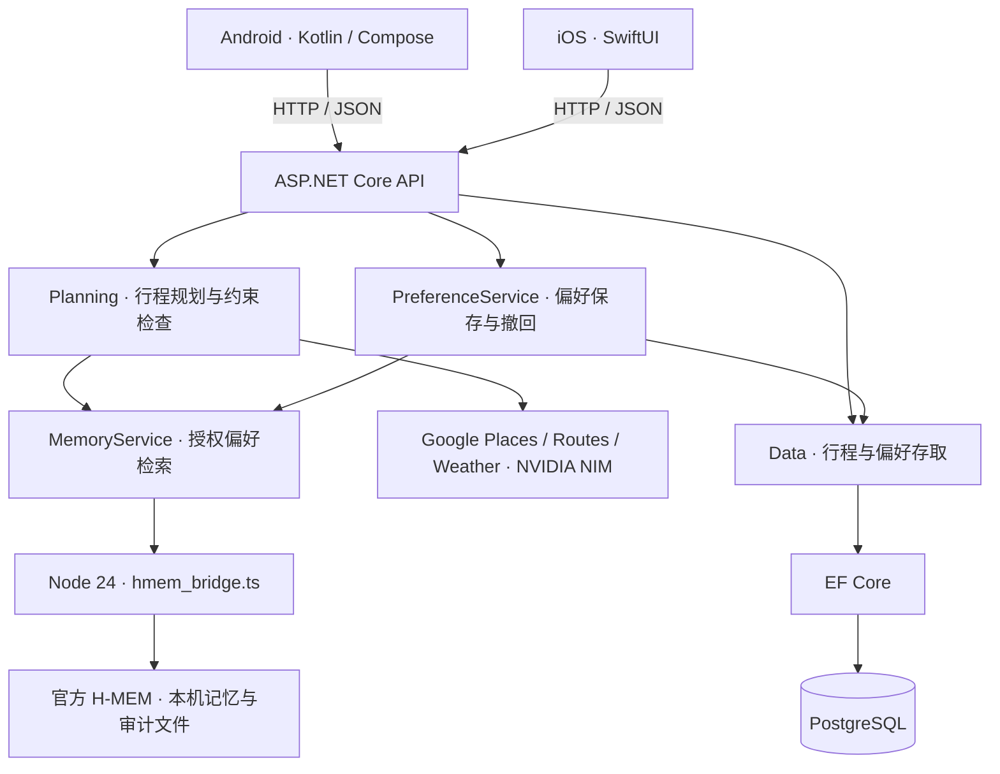

# Sydney Buddy · 悉尼旅行 Agent

**原生 iOS（SwiftUI）、Android（Kotlin + Jetpack Compose）与 ASP.NET Core（C# / .NET 10）后端，通过 EF Core 和 PostgreSQL 保存行程与偏好。** 单题引导收集旅行偏好，NVIDIA Nemotron 推荐候选地点，程序独立检查路线约束，再由用户确认保存。地图、地点、路线与天气使用 Google Maps Platform，授权偏好检索使用官方 Meterless H-MEM 引擎。

当前维护原生 iOS、Android 及其共用的 C# API。React 网页客户端与独立的旧版 React/.NET 原型已移除。Android 与保留的 SwiftUI iOS 客户端继续使用原接口、JSON 字段和 `8787` 端口。旧 Python 代码与 SQLite 文件保留供对照和回退；新后端不运行 Python，也不会自动导入旧 SQLite 数据。**当前仍为本机单用户原型，未部署线上服务，也未提交 HackOS。**

完整迁移范围与代码阅读说明见 [迁移说明](docs/ASPNET-MIGRATION.md)。

## 功能与边界

- 悉尼市区 1–3 天步行规划，8 个限定候选地标，每天最多 4 站，跨天不重复。
- Nemotron 只对已知地点 ID 排序；C# 代码独立检查预算、步数、营业时间、休息、衔接和返程。
- 调整先生成草案，用户确认后才保存。保存使用版本检查，冲突返回 HTTP `409`。
- 多行程管理、逐日天气刷新，以及需用户同意的偏好保存和撤回。
- Google Places 提供坐标与常规营业时段，Routes 提供步行路线，Weather 提供未来 10 天逐日预报。
- Android 原有引导、准备清单与整数分记账保留，准备进度与账本保存在设备本机。

## 本机启动：PostgreSQL + .NET API

需要 **.NET 10 SDK**、**Node.js 24** 和 **Docker / Docker Compose**。Node 仅用于官方 Meterless H-MEM 引擎；HTTP API、规划与天气逻辑由 C# 运行。

在包含本次迁移的仓库根目录运行：

```sh
docker compose up -d db
```

Compose 的本机开发数据库为 `localhost:55432`，数据库名 `sydneybuddy`，用户名为 `sydneybuddy`，密码为 `sydneybuddy_dev`。这些值只适用于本机开发。按终端设置连接字符串，再启动 API：

**Windows PowerShell**

```powershell
$env:ConnectionStrings__SydneyBuddy = 'Host=localhost;Port=55432;Database=sydneybuddy;Username=sydneybuddy;Password=sydneybuddy_dev'
dotnet run --project server-dotnet/SydneyBuddy.Api
```

**macOS / Linux**

```sh
export ConnectionStrings__SydneyBuddy='Host=localhost;Port=55432;Database=sydneybuddy;Username=sydneybuddy;Password=sydneybuddy_dev'
dotnet run --project server-dotnet/SydneyBuddy.Api
```

首次运行会还原 NuGet 依赖，API 启动时使用 EF Core migrations 创建或更新 PostgreSQL 表。先关闭旧 Python 后端，避免争用 `8787` 端口。服务运行后打开 [健康检查](http://127.0.0.1:8787/health) 或 [本机密钥设置页](http://127.0.0.1:8787/setup)。每位成员使用自己的本机数据库；这仍是单用户开发模式。

也可通过启动脚本运行：Windows 使用 `powershell -File scripts/start-server.ps1`；macOS / Linux 使用 `sh scripts/start-server.sh`；macOS 也可双击 `scripts/start-server.command`。连接字符串仍需先设置在对应进程的环境中。

## Android（Windows / macOS）

额外需要 Android Studio、Android SDK 35、JDK 17 或 21，以及带 Google Play 服务的 Android 8.0+ 模拟器或手机。

1. 先按上文启动 PostgreSQL 和 .NET API。
2. Android Studio 打开 **`android/`**，等待 Gradle 同步。
3. 连接已开启 USB 调试的手机，或启动模拟器。
4. Windows 运行 `powershell -File scripts/connect-android.ps1`；macOS 运行 `sh scripts/connect-android.sh`，将设备端口转发到电脑。
5. 在 Android Studio 运行 `app`。不配置 Google 密钥即可使用默认 OSM 底图与演示行程；连线明确标注为示意，不是导航路线。

每次重启模拟器或重新连接手机后，需要重做端口转发。若 `adb` 不在 PATH，连接脚本会尝试从 `ANDROID_HOME` 或默认 SDK 路径查找。命令行构建在 `android/` 中执行：

```sh
# macOS / Linux；Windows 使用 .\gradlew.bat
sh gradlew :app:assembleDebug :app:testDebugUnitTest :app:lintDebug
```

APK 输出为 `android/app/build/outputs/apk/debug/app-debug.apk`。真实 Google 底图需要单独的 Maps SDK for Android 密钥，写入被忽略的 `android/local.properties`：`MAPS_API_KEY=你的Android地图密钥`；保留 Android Studio 生成的 `sdk.dir`。iOS 地图密钥不通用，具体密钥限制由项目管理员管理。

Android 仍连接 `http://127.0.0.1:8787`。Debug 允许本机 HTTP，Release 禁止明文连接。独立联网 APK 需要 HTTPS 后端、客户端地址与身份认证；本次技术栈迁移不包含应用商店发布或云端部署。现有 [Android 验证记录](docs/ANDROID-VERIFICATION.md) 属于迁移前的历史证据。

## 保留的 iOS 客户端

需要 macOS、Xcode（iOS 17+ SDK/模拟器）、.NET 10 SDK 和 Node.js 24。先启动 PostgreSQL 和 .NET API，再打开 `ios/SydneyBuddy.xcodeproj`，运行 `SydneyBuddy` scheme。首次 Xcode 构建需联网下载 Google Maps SDK。

同机模拟器继续连接 `127.0.0.1:8787`；iPhone 真机不能用其自身的回环地址访问电脑。iOS 地图密钥更改后需要重新构建。原 [iOS 验证记录](docs/VERIFICATION.md) 是迁移前的历史记录，不能替代新版验证。

## 切换地图底图与免费开发模式

在 App 的 **“我的” → “地图底图”** 选择来源。新安装默认使用 OpenStreetMap，选择会保存在各自设备，重新打开 App 仍有效。地图切换不会调用 `/plan` 或保存 / 修改行程；镜头位置在本次 App 运行期间共用，新行程或不同日期会重新定位。

| 底图 | Android | iOS | 说明 |
|---|---|---|---|
| OpenStreetMap | MapLibre Native | MapKit + 替换底图的 `MKTileOverlay` | 无需 Google 金钥，需联网取得 OSM 图砖 |
| Apple Maps | 不提供 | 原生 MapKit | 使用 Apple 底图，需联网 |
| Google Maps | 原有 Maps SDK | 原有 Maps SDK | 需配置各自平台的地图金钥；缺少金钥会明确提示，不自动切换来源 |
| 离线示意图 | 支持 | 支持 | 不加载网络底图，只绘制示例位置和连线，不提供导航 |

OSM / Apple Maps 的示例景点连线不是道路导航。`live` 行程含 Google Places / Routes 内容时，其他底图会隐藏整份地图图层并提示切回 Google；行程列表与原始数据仍保留，不把 Google 路径重新绘制到其他地图。参见 [Google Routes 政策](https://developers.google.com/maps/documentation/routes/policies)。

OSM 公共图砖只用于少量交互开发：请求包含 App 的 User-Agent，保留可见版权署名，遵守 HTTP 缓存，不提供预下载和离线区域下载。公共服务没有可用性保证，正式规模使用需评估其他图砖供应商或自架服务。图砖加载受网络影响时可选离线示意图。[OSM 使用政策](https://operations.osmfoundation.org/policies/tiles/)

### 后端付费服务开关

**底图来源和后端数据模式是两项独立设置。** 后端新增 `AllowPaidServices`，预设为 `false`：

- `demo` 规划仍可运行，保存 / 读取行程和本机 H-MEM 不受影响。
- `assisted`、`live` 规划及实时天气刷新会在调用外部服务前返回 `422`，即使已经配置服务端金钥。
- `/health` 回传 `paidServicesAllowed`；手机据此停用在线推荐开关。
- 这项保护针对后端 NVIDIA / Google HTTP 请求，不是地图 SDK、图砖网络或账户账单的总额度控制。

确实需要测试在线服务时，由后端开发者明确开启并重启服务，例如 macOS / Linux：

```sh
AllowPaidServices=true dotnet run --project server-dotnet/SydneyBuddy.Api
```

PowerShell 先运行 `$env:AllowPaidServices='true'` 再启动后端。仅在手机切换底图不会开启这项权限；测试结束后移除环境变量或设为 `false` 并重启。日常开发建议使用 **OSM + demo**；完全不加载网络底图时使用 **离线示意图 + demo**。

## 配置

仓库只提供配置模板，不包含可用服务密钥。服务端读取仓库根目录 `.secrets.json` 或同名环境变量，环境变量优先；不会自动加载 `.env`。Node H-MEM 数据继续保存在 `server/.hmem/`。

| 配置项 | 用途 |
|---|---|
| `ConnectionStrings__SydneyBuddy` | PostgreSQL 连接字符串 |
| `NVIDIA_API_KEY` | 服务端调用 NVIDIA NIM，不进入 Android APK 或 iOS App |
| `NVIDIA_MODEL` | 默认 `nvidia/nemotron-3.5-lightning-30b-a3b` |
| `GOOGLE_SERVER_KEY` | 服务端 Places API (New)、Routes API、Weather API |
| `GOOGLE_IOS_KEY` | 保留的 iOS 客户端地图 SDK 配置 |
| Android `MAPS_API_KEY` | 仅写入 `android/local.properties` 的 Android 地图 SDK 密钥 |
| `NODE_BINARY` | 可选，Node 24 可执行文件路径；默认从 PATH 查找 |
| `SYDNEYBUDDY_ROOT` | 可选，仓库根目录绝对路径，自动定位失败时设置 |

API 密钥也可通过本机 `/setup` 页面保存。模板见 [.secrets.example.json](.secrets.example.json) 和 [Secrets.example.xcconfig](ios/Config/Secrets.example.xcconfig)。单独设置 iOS 环境变量不会自动生成客户端构建配置；应通过设置页或手动填写 xcconfig。

Google 项目需要启用计费及对应服务。地图 SDK 与服务端 API 分别配置。`/health` 显示已配置，不代表模型、地图、路线或天气真实调用成功；费用参考 [Google 官方价格](https://developers.google.com/maps/billing-and-pricing/pricing)。

## 模式和天气

| 模式 | 模型 | 其他数据 |
|---|---|---|
| `demo` | 本地规则，不调用 AI | 示例地点、天气、营业时段与距离估算 |
| `assisted` | 真实 Nemotron | 示例地点、天气和路线，不请求 Google 服务端 API |
| `live` | 真实 Nemotron | Google Places、Routes、Weather；花费、场内步数与停留时间仍为估算 |

天气按悉尼旅行日期逐日匹配，并分别影响当天室内/室外筛选。Weather 请求未来 10 天、`pageSize=10`，超时 8 秒；失败或超出范围时明确显示未知。独立刷新天气不会重排已保存行程，调整仍需生成并确认草案。雨天快捷情景明确标注为用户指定，不能当成实时天气证据。

## API 兼容性

本机服务仍使用 `127.0.0.1:8787`，无账户系统，保留本机来源检查。JSON 请求使用 `Content-Type: application/json`。

| 方法 / 路径 | 说明 |
|---|---|
| `GET /health` | 服务状态与配置是否存在，不返回密钥 |
| `GET /catalog` | 8 个候选地点的示例基础数据 |
| `POST /plan` | 按 profile 和 mode 生成草案，不保存 |
| `POST /weather` | 刷新天气，不保存或重排行程 |
| `GET /trips` | 已保存行程 |
| `POST /trips` | `{ "trip": <草案>, "expectedRevision": 0 }`；修改时传当前 revision |
| `DELETE /trips/{id}` | 删除指定行程 |
| `GET /memories` | 已保存的授权偏好 |
| `POST /memories` | `{ "consent": true, "summary": "喜欢艺术", "profile": {"interests":["艺术"],"maxSteps":5000} }` |
| `DELETE /memories/{id}` | 从可检索记忆撤回，保留追加审计历史 |
| `GET/POST /setup` | 本机配置页，提交需要页面提供的 CSRF 令牌 |

Android / iOS 使用上述接口。服务不再托管 React 静态文件或注册旧网页的 `/api` 别名；根路径 `/` 返回 JSON 404，本机配置仍从 `/setup` 进入。约束无可行解为 `422`，保存版本冲突为 `409`，非法来源为 `403`。API 不执行订票、付款或赛事提交。

## 测试与 CI

```sh
dotnet restore server-dotnet/SydneyBuddy.Api.Tests/SydneyBuddy.Api.Tests.csproj
dotnet build server-dotnet/SydneyBuddy.Api.Tests/SydneyBuddy.Api.Tests.csproj --no-restore
dotnet test server-dotnet/SydneyBuddy.Api.Tests/SydneyBuddy.Api.Tests.csproj --no-build
# macOS / Linux：官方 H-MEM conformance
HMEM_IMPL="$PWD/server/vendor/hmem/src/index.ts" \
  node --experimental-transform-types server/vendor/hmem/conformance/runner.ts
```

后端集成测试在上述 PostgreSQL 连接中创建专属随机 schema，完成后清理；连接用户需要创建 schema 的权限。详细说明见 [迁移说明](docs/ASPNET-MIGRATION.md)。GitHub Actions 启动 PostgreSQL 服务，使用 .NET 10 构建与测试，运行 H-MEM 检查。Android 继续使用原构建工作流。自动测试不调用付费 API。迁移后的测试结果以当前 CI 和迁移说明为准；原 Python / Android / iOS 版本的成功记录不能直接作为新版在线或真机验收结果。

## 项目结构

| 路径 | 职责 |
|---|---|
| `android/` | Kotlin / Jetpack Compose Android 客户端 |
| `ios/` | 保留的 SwiftUI 客户端 |
| `server-dotnet/SydneyBuddy.Api/` | ASP.NET Core REST API、C# 规划、天气、依赖注入、EF Core / PostgreSQL 存储 |
| `server-dotnet/SydneyBuddy.Api.Tests/` | 新后端的单元与 HTTP 兼容性测试 |
| `server/places.json` | 沿用的候选地点基础数据 |
| `server/hmem_bridge.ts`、`server/vendor/hmem/` | 由 C# 调用的官方 H-MEM 引擎与许可 |
| `server/.hmem/` | 本机记忆与审计数据，Git 忽略目录 |
| `server/*.py`、`server/tests/` | 旧 Python 实现和对照测试，不参与新后端运行 |
| `compose.yaml` | 本机 PostgreSQL 开发服务 |

## 程序架构与数据流

手机 App 负责界面、交互和设备本机状态；ASP.NET Core 负责规划规则、外部服务调用和数据库。两端通过 HTTP / JSON 沟通，手机不会直接连接 PostgreSQL。开发时后端运行在电脑上；未来可部署到服务器，再将手机的 API 地址改为 HTTPS 服务地址，无需把后端放进手机。



Google 地图底图由 Android / iOS 各自的 Maps SDK 显示；后端的 Places、Routes 和 Weather 则提供地点、路线和天气资料。手机地图 SDK 使用各自平台的地图密钥，NVIDIA 与 Google 服务端密钥留在后端。

一次行程操作分为两阶段：

1. **生成草案**：手机收集偏好 → `POST /plan` → 验证输入 → 收集地点、天气和推荐 → 检查整条路线 → 返回草案。此时不保存行程。
2. **确认保存**：用户确认 → `POST /trips`，传入草案及 `expectedRevision` → 检查行程结构和版本 → 写入 PostgreSQL。旧版本提交返回 `409`，手机需要刷新后再调整。

| 数据 | 保存位置 | 负责部分 |
|---|---|---|
| 已确认行程、revision、授权偏好摘要 | PostgreSQL | C# Repository / EF Core |
| 偏好检索内容与追加审计记录 | `server/.hmem/` | 官方 H-MEM，经 C# 调用 Node |
| 默认旅行偏好、准备进度、记账 | 各自手机的本机存储 | Android `BuddyStore`、iOS `AppStore` |
| 服务端配置与密钥 | 环境变量或被 Git 忽略的 `.secrets.json` | `SecretStore` |

设备本机数据目前不跨手机同步。PostgreSQL 偏好摘要与 H-MEM 是两个存储，`PreferenceService` 协调它们；数据库保存失败时尝试撤回刚添加的记忆，不是跨存储事务。

## 主要文件用途

### Android 前端

以下 Kotlin 文件都位于 `android/app/src/main/java/com/sydneybuddy/travel/`。

| 文件 | 用途与常见修改场景 |
|---|---|
| `MainActivity.kt` | App 入口、主画面切换，以及草案、行程列表、AI 调整、记账和设置画面；修改主流程时从这里看起 |
| `IosStyle.kt` | Android 的 iOS 风格首页、8 步引导、日历、导航及共用视觉元件；这是 Kotlin Android 文件，不是 iOS 代码 |
| `BuddyStore.kt` | ViewModel 状态、HTTP 请求、草案与行程操作、天气和偏好操作、本机资料保存；也是 Android 后端地址的设置位置 |
| `Domain.kt` | 旅行偏好与起终点模型、JSON 转换、输入检查、整数分金额与均分、保存载荷、路线 polyline 解码 |
| `RouteMap.kt` | 统一底图入口、Google / 离线示意图，以及 Google 内容的图层隔离 |
| `MapProvider.kt` | 底图选项、共用镜头状态、OSM / MapLibre 显示及图砖请求识别和缓存 |

| 配置 / 测试文件 | 用途 |
|---|---|
| `android/app/build.gradle.kts` | SDK、App 版本、依赖、地图金钥引用与测试依赖 |
| `android/app/src/main/AndroidManifest.xml` | 入口 Activity、网络权限、地图 SDK 与安全设置 |
| `android/app/src/main/res/` | 图示、系统主题、备份与网络安全规则；`src/debug/res/` 覆盖本机开发网络规则 |
| `android/app/src/test/java/com/sydneybuddy/travel/DomainTest.kt` | 金额、模型、版本保存与路线解码的单元测试 |
| `android/app/src/androidTest/java/com/sydneybuddy/travel/BuddyFlowTest.kt` | 在模拟器 / 装置操作引导、保存、取消调整、准备清单与记账流程；需后端和端口转发 |

### iOS 前端

Swift 文件位于 `ios/SydneyBuddy/`。`Models.swift` 同时包含数据模型和 `AppStore`，不只是类型声明。

| 文件 | 用途与常见修改场景 |
|---|---|
| `SydneyBuddyApp.swift` | App 入口、根画面、8 步引导，以及 Buddy 角色、颜色和共用按钮 |
| `Models.swift` | API 数据模型、`AppStore` 状态管理、网络请求、草案与保存流程、本机存储；也是 iOS 后端地址的设置位置 |
| `MapView.swift` | 首页、底图统一入口、OSM / Apple / Google 实作、镜头状态与离线示意图 |
| `TripViews.swift` | 行程草案、确认保存、AI 调整、行程列表、天气与出发准备画面 |
| `SettingsViews.swift` | 记账、设置，以及需要同意的偏好保存与撤回画面 |
| `ios/Config/Base.xcconfig`、`Secrets.example.xcconfig`、`Info.plist` | 建置设置、本机地图金钥范本与 App 配置，实际配置目录为 `ios/Config/` |
| `ios/SydneyBuddy.xcodeproj/project.pbxproj` | Xcode 工程、来源文件、建置目标与 Google Maps 套件设置 |

### ASP.NET Core 共用后端

后端按用途分层，目录如下。表中的路径相对于 `server-dotnet/SydneyBuddy.Api/`。

```text
server-dotnet/
├── SydneyBuddy.Api/
│   ├── Program.cs          启动、依赖注册、数据库迁移与路由
│   ├── Api/                HTTP 请求与响应边界
│   ├── Planning/           行程业务规则与调度
│   ├── Services/           天气、外部请求和记忆整合
│   ├── Data/               EF Core 模型、数据库迁移和存取
│   └── Infrastructure/     配置、资源路径及共用工具
└── SydneyBuddy.Api.Tests/  后端单元与整合测试
```

| 文件 | 用途 |
|---|---|
| `Program.cs` | 设置端口与请求限制，注册服务，启动时应用数据库迁移，并挂上手机 API |
| `Api/ApiEndpoints.cs` | 组合规划、行程、偏好与设置的路由模块 |
| `Api/PlanningEndpoints.cs` | 健康状态、景点目录、生成草案与天气接口 |
| `Api/TripEndpoints.cs` | 已保存行程的查询、保存、删除及版本冲突响应 |
| `Api/MemoryEndpoints.cs` | 授权偏好的查询、保存和撤回接口 |
| `Api/SettingsEndpoints.cs`、`SetupPage.cs` | 本机 `/setup` 配置表单及 CSRF 检查；不是 React 网页客户端 |
| `Api/RequestJson.cs`、`TripContractValidator.cs` | 读取 JSON 请求，以及检查保存草案的数据结构 |
| `Api/LocalRequestMiddleware.cs` | 本机访问限制、响应头、统一错误处理与请求日志 |
| `Planning/Planner.cs` | 编排输入验证、地点、天气、推荐和调度，返回未保存草案 |
| `Planning/PlanValidator.cs` | 检查并补全日期、天数、预算、步数、时间与起终点 |
| `Planning/PlaceCatalog.cs`、`CatalogCache.cs` | 读取及缓存本机景点目录；不缓存私人偏好或实时天气 |
| `Planning/PlaceService.cs` | 取得示例或 Google Places 候选地点 |
| `Planning/RecommendationService.cs` | 检索授权偏好，并在在线模式调用 Nemotron 对已知地点排序 |
| `Planning/RouteService.cs` | Google 步行路线查询、演示距离估算与本次规划内的路段复用 |
| `Planning/RouteScheduler.cs` | 安排多日景点顺序，检查营业窗口、转场、休息、预算、步数和返程 |
| `Planning/PlanningContext.cs` | 单次规划的模式、配置快照、证据记录与路段缓存 |
| `Services/WeatherService.cs` | 天气查询、逐日匹配，以及范围外或查不到资料的处理 |
| `Services/ExternalJsonClient.cs` | 外部 HTTP / JSON 请求、超时和提供商错误处理 |
| `Services/MemoryService.cs` | 管理 Node 子进程，调用 H-MEM，控制并发和超时 |
| `Services/PreferenceService.cs` | 协调 H-MEM 与 PostgreSQL 的偏好摘要保存和撤回 |
| `Data/BuddyDbContext.cs` | EF Core 实体、表与 JSONB 字段映射 |
| `Data/TripEntity.cs`、`MemoryEntity.cs` | 行程与授权偏好摘要的数据库实体 |
| `Data/TripRepository.cs` | 行程查询、保存、删除与原子 revision 检查 |
| `Data/MemoryRepository.cs` | 授权偏好摘要的数据库存取 |
| `Data/Migrations/` | 数据库结构变更及模型快照；修改表结构时维护迁移 |
| `Infrastructure/DependencyInjection.cs` | 集中注册服务与生命周期；DbContext / Repository 随请求建立 |
| `Infrastructure/PaidServicePolicy.cs` | 后端付费请求的明确启用策略，预设拒绝 |
| `Infrastructure/ProjectPaths.cs` | 定位仓库、景点资料、密钥及 H-MEM 目录 |
| `Infrastructure/SecretStore.cs` | 读取环境变量 / 私有配置，保存本机配置及 iOS 地图设置 |
| `Infrastructure/JsonExtensions.cs`、`ServiceException.cs` | JSON 字段读取工具与业务错误类型 |
| `SydneyBuddy.Api.csproj` | .NET 目标版本、EF Core 和 PostgreSQL 依赖 |

### 共享资料、工具与历史代码

| 路径 | 用途 |
|---|---|
| `server/places.json` | 当前 C# 后端仍在读取的景点基础资料 |
| `server/hmem_bridge.ts` | 将 C# 的记忆操作转交给官方引擎；删除 React 后仍需保留 |
| `server/vendor/hmem/` | 第三方记忆引擎、相容性测试、来源与独立许可，通常不直接改动 |
| `server/*.py`、`server/requirements.txt`、`server/tests/` | 历史 Python 后端和对照测试；当前启动脚本与 .NET API 不使用它们 |
| `scripts/start-server.sh`、`.command`、`.ps1` | 各平台的 .NET 后端启动入口 |
| `scripts/connect-android.sh`、`.ps1` | Android 装置到电脑后端的 `adb reverse` 端口转发 |
| `scripts/generate_project.py` | 重新产生 iOS Xcode 工程与 Info.plist 的辅助工具，日常启动不需执行 |
| `compose.yaml` | 本机 PostgreSQL 容器、端口、健康检查与持久化 volume |
| `global.json` | .NET SDK 版本选择规则 |
| `.secrets.example.json` | 服务端配置范本；实际 `.secrets.json` 不提交 Git |
| `.github/workflows/ci.yml` | PostgreSQL、.NET 后端测试与官方 H-MEM 检查 |
| `.github/workflows/android.yml` | Android APK 建置、领域测试及静态检查 |
| `docs/` | 迁移说明、历史验证记录、截图、演示与参赛清单 |

## 团队分工与建议阅读顺序

| 小组 / 工作 | 主要修改位置 | 需要共同约定的事项 |
|---|---|---|
| Android 前端 | Kotlin 画面、`BuddyStore.kt`、`Domain.kt` | API JSON、错误码、载入与保存状态 |
| iOS 前端 | SwiftUI 画面、`Models.swift` 中的 `AppStore` | 与 Android 一致的业务流程和 API 契约 |
| 后端业务 | `Api/`、`Planning/`、`Services/` | 字段含义、可行性规则、失败情境 |
| 数据库与整合 | `Data/`、`Infrastructure/`、Compose | 迁移、配置、版本冲突与资料边界 |

前后端保留在同一个仓库即可独立分工。修改 API 字段时同时核对 Android 的 JSON 转换、iOS 的 Codable 模型及后端 HTTP 测试；修改业务约束时优先从后端规划层处理。Android 的画面和 iOS 的模型 / 状态管理目前集中在少数文件，同组多人同时修改时应先约定负责范围。

第一次接手建议依序阅读：

1. **画面入口**：Android `MainActivity.kt` / `IosStyle.kt`，或 iOS `SydneyBuddyApp.swift`，了解用户流程。
2. **请求与状态**：Android `BuddyStore.kt`，或 iOS `Models.swift`，追踪产生草案和确认保存。
3. **HTTP 边界**：`PlanningEndpoints.cs` / `TripEndpoints.cs`，了解请求如何进入后端。
4. **业务规则**：`Planner.cs` → `PlanValidator.cs` → `RouteScheduler.cs`，理解模型推荐与程序验证的分工。
5. **持久化**：`TripRepository.cs` → `BuddyDbContext.cs`，理解确认保存和 revision 冲突。
6. **验证**：阅读 `SydneyBuddy.Api.Tests/` 与 Android 的测试，了解已有案例和环境需求。

## 限制与黑客松状态

- 限定 8 个悉尼地标、步行模式，每天最多尝试 8 个初筛候选顺序，不保证全局最优。Google 常规营业时段可能不适用于节假日。
- 花费、步数和停留时间为估算；没有住宿、全部餐饮、实时票价、排队、坡度或无障碍模型。
- 没有多人账户、共享同步、支付、订票、酒店预订、航班追踪或后台 GPS。PostgreSQL 支持存储，并不自动提供用户隔离或云端同步。
- H-MEM 为本机单用户，撤回后不再检索，但审计历史保留；未启用自动 dreaming / sleep。
- 原 Python 版本有 NVIDIA NIM 和 H-MEM 验证记录；迁移后的真实在线功能需使用本机配置重新验收。Cursor、Zetaris 按团队原要求暂缓，Nightshift 未接入；不声称满足全部赛事要求。见 [参赛清单](docs/submission-checklist.md)。
- `docs/` 中既有截图与视频描述迁移前版本；当前原生客户端与 .NET 后端以代码和测试结果为准。

## 来源与许可

项目沿用 [MIT 许可证](LICENSE)。`server/vendor/hmem` 保留官方参考实现的 Apache-2.0 许可和 [来源说明](server/vendor/hmem/UPSTREAM.md)。Google SDK 及在线服务受各自条款约束。

[Google Maps iOS](https://developers.google.com/maps/documentation/ios-sdk/config) · [Places](https://developers.google.com/maps/documentation/places/web-service/text-search) · [Routes](https://developers.google.com/maps/documentation/routes/compute_route_directions) · [Weather](https://developers.google.com/maps/documentation/weather/overview) · [NVIDIA NIM](https://docs.api.nvidia.com/nim/reference/llm-apis) · [Meterless](https://github.com/Meterless/Meterless/tree/main/engines/hmem)

交互借鉴 Duolingo 的小步学习、即时反馈与完成奖励，使用原创 Buddy 角色；本项目与 Duolingo 无关联。
