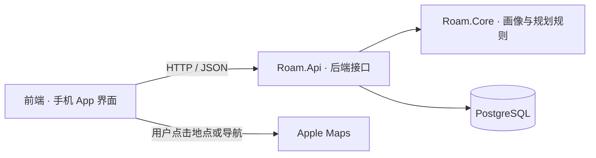

# 五人团队的前后端基本框架

这是当前可运行 MVP 的实际目录分工。前端使用 React + TypeScript，后端使用 .NET 10，数据存入 PostgreSQL；Docker Compose 启动应用与数据库。

## 整体关系



前端负责展示与收集输入。后端校验请求、生成行程并保存数据。HP、预算、时间等约束以规划核心返回的结果为准。

## 顶层目录

```text
hackathon/
├── client/                     前端项目
│   └── src/
│       ├── app/                App 状态、页面切换、全局流程
│       ├── components/         公共图标、卡通伙伴等
│       ├── features/
│       │   ├── profile/        问答、固定画像、雷达
│       │   ├── tasks/          创建任务表单
│       │   ├── trips/          行程列表、详情、历史版本
│       │   └── maps/           地图页与 Apple Maps 链接
│       ├── services/           HTTP 请求与业务接口调用
│       ├── types/              与后端对齐的数据类型
│       ├── utils/              日期、时间、金额格式化
│       ├── styles/             公共主题和样式
│       └── main.tsx            前端挂载入口
├── src/
│   ├── Roam.Api/               .NET 接口与数据存取
│   │   ├── Features/           按画像、行程、系统拆分接口
│   │   ├── Contracts/          请求与响应数据结构
│   │   ├── Infrastructure/     数据访问、初始化、异常处理
│   │   ├── Database/           PostgreSQL 建表脚本
│   │   └── Program.cs          应用启动与装配
│   └── Roam.Core/              独立业务规则，不依赖网页或数据库
│       ├── Profiles/           问答答案到固定属性的计算
│       ├── Planning/           行程生成、约束与轻松版
│       └── Models/             画像、地点、行程等核心模型
├── tests/Roam.Core.Tests/      规划核心的测试
├── scripts/                    启动、HTTP、地图链接与持久化检查
├── docs/                       项目说明、接口与验证记录
├── .github/workflows/ci.yml    自动构建与检查
├── Dockerfile                  前端与 .NET 多阶段构建
├── compose.yaml                应用 + PostgreSQL
└── Roam.slnx                   后端项目与测试的 IDE 入口
```

## 五个人各自改哪里

| 成员 | 主要负责目录 | 负责内容 |
| --- | --- | --- |
| 前端 1 | `client/src/features/profile/`、`features/tasks/` | 六步问答、固定雷达、创建任务；维护公共视觉组件和主题 |
| 前端 2 | `client/src/features/trips/`、`features/maps/` | 行程列表、详情、历史版本、地图与 Apple Maps |
| 后端 1 | `src/Roam.Core/`、`tests/Roam.Core.Tests/` | 画像规则、行程搜索、HP / 预算 / 时间 / 坡度 / 返程约束 |
| 后端 2 | `src/Roam.Api/` | API、PostgreSQL、参数校验、幂等、行程版本和数据保存 |
| 集成与部署 | `scripts/`、`Dockerfile`、`compose.yaml`、`.github/`、`docs/` | 联调、容器、自动检查、运行说明和验收 |

`app/App.tsx` 负责模块之间的连接，由集成人协调修改。公共 `components/`、`styles/` 和 `types/` 变更需要两位前端对齐；修改请求 / 响应字段时，同时更新后端 `Contracts/` 和前端 `types/`。

## 前后端接口边界

| 请求 | 前端用途 | 后端职责 |
| --- | --- | --- |
| `GET /api/bootstrap` | 打开 App，恢复画像和任务列表 | 从数据库读取已保存内容 |
| `POST /api/profiles` | 六问完成后创建角色 | 从答案派生六维属性，固定保存画像 |
| `POST /api/trips` | 创建任务并生成完整行程 | 校验输入，调用规划器，保存任务和 V1 |
| `GET /api/trips/{id}` | 查看行程或地图任务 | 读取请求、状态和全部行程版本 |
| `POST /api/trips/{id}/replan` | 生成更轻松的安排 | 使用原任务要求重算，追加版本 |
| `GET /health` | Docker 与运行检查 | 检查后端和 PostgreSQL 是否正常 |

所有业务响应使用 JSON，字段采用 camelCase。画像 API 接收六个答案，每题为 0 / 1 / 2；创建任务包含 `profileId`、`title`、`date`、`startTime`、`endTime`、`budget`、`energy`、`theme`、`notes` 和 `idempotencyKey`。请求编号用于避免重复创建，前端自动生成。

目前前端地图通过 Apple 的官方 HTTPS 链接打开地点 / 导航；没有内嵌 Apple 底图，也没有将真实地图耗时写回规划器。详见 [Apple Maps 功能说明](APPLE-MAPS.md)。

## 一次「生成行程」的完整调用

```text
TaskForm 收集本次要求
    ↓
services/travelApi.ts 发送创建任务请求
    ↓
Roam.Api / Features / Trips 校验请求
    ↓
Roam.Core / Planning / Planner 生成可行行程或冲突原因
    ↓
Infrastructure / Persistence 保存任务及版本到 PostgreSQL
    ↓
返回完整 JSON，前端展示行程、HP、预算与返程时间
```

## 每个人如何启动和检查

完整启动沿用仓库根目录：

```sh
docker compose up --build --detach --wait
```

访问 `http://127.0.0.1:5080`。数据库保存在命名卷，正常停止使用 `docker compose down`。

前端开发：先启动后端，再在 `client/` 内运行：

```sh
pnpm install --frozen-lockfile
pnpm dev
```

Vite 将 `/api`、`/health` 转发到本地后端，默认端口 5080。`ROAM_API_ORIGIN` 可以指定独立测试后端；生产构建使用同源接口。

前端检查：

```sh
cd client
pnpm build
```

后端编译与规划测试，在仓库根目录执行：

```sh
dotnet build Roam.slnx --configuration Release
dotnet run --project tests/Roam.Core.Tests --configuration Release
```

启动后端与 PostgreSQL 后再运行真实 HTTP 验收；这会创建测试任务，应指向专用测试数据库：

```sh
node scripts/smoke.mjs
```

Apple Maps 链接检查无需运行服务：

```sh
node scripts/check-map-links.mjs
```

现有 CI 负责前端构建、地图链接检查、核心测试、后端编译、Docker 启动、HTTP 验收和重启后的数据持久化检查。

## 当前范围

先维护单人、悉尼、一日游的完整闭环。问答生成画像后保持固定；行程条件在任务中填写。地点、费用、交通时间和 HP 仍为示例估算，自由文本备注只保存。账号、多人协作、预订支付、真实地图服务和原生安装包可以在这套目录中逐步扩展。
