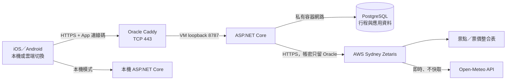

# Oracle Always Free 後端

本分支將 ASP.NET Core、Node.js 24（H-MEM）及 PostgreSQL 放到同一台免費 VM。Zetaris 引擎不放在這台小型 VM；已有的雲端 Zetaris 可由後端另行連線。

## 這次使用的 E2 Micro

2026-10-26 使用者另建成功的主機為 `instance-20261026-1101`，區域 Sydney，規格 `VM.Standard.E2.1.Micro`，Oracle Linux 9，SSH 使用者 `opc`。初次開機系統回報約 498 MiB，重新開機後約 945 MiB 實體記憶體；這是小型連線測試主機，不能套用下面 Ubuntu A1 的安裝命令。

在本機依下方步驟打包、解開來源包後建置 x86 映像，再部署；建置目錄必須是打包解開的公開來源目錄，避免把個人資料帶進映像：

```sh
docker build --platform linux/amd64 -t sydneybuddy-api:oracle-amd64 -f infra/oracle/Dockerfile .
docker save sydneybuddy-api:oracle-amd64 | gzip > /secure/path/backend-amd64.tar.gz
python3 scripts/oracle_micro.py --host YOUR_VM_IP --key /secure/path/id_ed25519 --image /secure/path/backend-amd64.tar.gz
```

Micro 工具只安裝 Oracle 官方 BaseOS／AppStream 的 Podman，避免解析大型 OCI 附加套件庫耗盡記憶體。在既有磁碟內加入 2 GiB 交換檔，不新增雲端磁碟。映像經 SHA-256 校驗後載入；PostgreSQL 與 API 由 Quadlet/systemd 管理、自動重啟，資料使用命名 volume。API 記憶體上限 320 MiB、資料庫 120 MiB，較重的 AI／多使用者工作仍可能超出這台主機能力。

SSH 只允許測試者 IP；API 只綁 `127.0.0.1:8787`，資料庫沒有公開連接埠。開啟測試通道：

```sh
python3 scripts/oracle_backend.py tunnel --host YOUR_VM_IP --user opc --key /secure/path/id_ed25519 --local-port 8790
```

VM 診斷：`sudo systemctl status sydneybuddy-api sydneybuddy-db`；記錄：`sudo journalctl -u sydneybuddy-api`。私有設定在 `/opt/sydneybuddy/api.env` 與 `database.env`，權限 0600，不覆寫既有設定，不進 Git。Podman 安裝依據：[Oracle Linux 官方文件](https://docs.oracle.com/en/operating-systems/oracle-linux/podman/install.html)。

## App 內切換後端

iOS／Android：**我的 → 後端連線 → 本機後端／雲端後端 → 套用並測試連線**。本機預設 `http://127.0.0.1:8787`；雲端短期測試使用 SSH 通道 `http://127.0.0.1:8790`。Android 另執行 `adb reverse tcp:8787 tcp:8787` 與 `adb reverse tcp:8790 tcp:8790`。網址分別保存在裝置上，重開 App 仍保留所選模式。

切換會重新載入所選後端的行程、偏好記憶及連線狀態；舊後端未完成的回應會被丟棄。不會把既有行程複製到另一端；本機帳本與裝置偏好仍留在裝置。切換控制項在規劃／寫入期間停用。對外伺服器網址只接受 HTTPS；HTTP 僅允許本機 loopback，不能填入公網 IP 的 HTTP。

這是**後端執行位置**的切換；「旅遊資料來源」的直接來源／Zetaris 是另一個設定。Oracle 尚未設定雲端 Zetaris 帳密時，先選直接來源。手機實體裝置的公開存取另需 HTTPS、登入及資料隔離，本次以兩個模擬器透過私人通道驗證。

## 免費資源範圍

2026-10-25 官方 Always Free 文件列出 A1 每月 1500 OCPU 小時、9000 GB 小時，約為全月 2 OCPU／12 GB；boot／block volume 合計 200 GB。僅適用 tenancy 的 home region，仍受剩餘額度與機房容量限制。

本次目標是 Sydney `ap-sydney-1`、`VM.Standard.A1.Flex` 1 OCPU／6 GB、Ubuntu 24.04 Minimal aarch64、50 GB 開機磁碟。只用標示免費資格的映像與規格，不用試用點數代替 Always Free 資格。建立前須確認現有資源及主控台費用；容量不足就停止，不切付費規格。閒置免費 VM 可能被 Oracle 回收。

官方資料：[Always Free resources](https://docs.oracle.com/en-us/iaas/Content/FreeTier/freetier_topic-Always_Free_Resources.htm)。

## 建立與初始化

1. 在 Oracle 主控台確認 Sydney 是 home region，先核對既有 VM 與磁碟用量。
2. 建立上述免費 VM，加入自己的 SSH 公鑰；私鑰留在個人電腦，不放進 Git。
3. SSH ingress 僅開給測試者來源 IP；不對外開 PostgreSQL 5432 或後端 8787。
4. 可在進階設定上傳 `cloud-init.yaml`，或 SSH 登入後自行安裝 Ubuntu 官方套件 `docker.io`、`docker-compose-v2`，啟用 Docker。

## 快速打包

在專案根目錄執行：

```sh
python3 scripts/package_oracle_backend.py --snapshot /secure/path/sydney-live-source.zip
```

只打包後端、H-MEM 程式、共享公開資料與部署設定。可選擇使用已驗證的 Zetaris 公開資料快照，重建 POI、秘境、OSM 及活動票價檔案。原始個人行程、對話、偏好與資料庫帳密不在包內。天氣維持即時 API。

輸出 `infra/oracle/bundles/*.tar.gz` 與 SHA-256。傳至自己 VM 的 `/opt/sydneybuddy`，核對 checksum 後解開到全新 release 目錄；不要覆蓋既有正式資料目錄。

Ubuntu VM 可用這個工具完成校驗、傳送與啟動；若尚未安裝 Docker，工具會從 Ubuntu 官方套件來源安裝 `docker.io` 與 `docker-compose-v2`：

```sh
python3 scripts/oracle_backend.py deploy --host YOUR_VM_PUBLIC_IP --key /secure/path/id_ed25519 --bundle infra/oracle/bundles/YOUR_RELEASE.tar.gz --dry-run
python3 scripts/oracle_backend.py deploy --host YOUR_VM_PUBLIC_IP --key /secure/path/id_ed25519 --bundle infra/oracle/bundles/YOUR_RELEASE.tar.gz
python3 scripts/oracle_backend.py status --host YOUR_VM_PUBLIC_IP --key /secure/path/id_ed25519
python3 scripts/oracle_backend.py tunnel --host YOUR_VM_PUBLIC_IP --key /secure/path/id_ed25519
```

工具只對指定 VM 操作；初次連線使用 OpenSSH 的首次信任機制記錄 host key，之後拒絕不符的主機金鑰。首次部署在 VM 生成新的私有資料庫密碼，既有 `.env` 不會覆蓋。更新仍保留同一組資料 volume。

## 啟動服務

在 VM 建立 `/opt/sydneybuddy/.env`（權限 `0600`），以 `.env.example` 為範本，將 `POSTGRES_PASSWORD` 改成隨機的長 hex 字串。可用 Python `secrets.token_hex(32)` 產生；不要保留範本密碼。供應商金鑰可留空，相關功能需補上金鑰後才可用。

在 release 的 `infra/oracle/.env` 建立指向私有設定的符號連結，再啟動：

```sh
ln -s /opt/sydneybuddy/.env /opt/sydneybuddy/RELEASE/infra/oracle/.env
sudo docker compose --env-file /opt/sydneybuddy/.env \
  -f /opt/sydneybuddy/RELEASE/infra/oracle/compose.yaml up -d --build --wait
curl --fail http://127.0.0.1:8787/health
```

API 以非 root 帳號執行。PostgreSQL 資料、H-MEM、寵物會話與私有設定分別保存在持久化 volume；重新建立容器不會清除它們。首次為新的應用資料庫，不會自動搬走本機個人資料。服務隨 Docker 自動重啟。

## 初版 SSH 通道測試（後續 HTTPS 方式見下方）

初版先透過 SSH 加密通道測試。此方式仍可作為管理與故障診斷備援；實體手機使用下方的 HTTPS 入口。另一個終端執行：

```sh
ssh -i /secure/path/id_ed25519 -NT -o ExitOnForwardFailure=yes \
  -o ServerAliveInterval=30 -L 127.0.0.1:8790:127.0.0.1:8787 ubuntu@YOUR_VM_IP
curl --fail http://127.0.0.1:8790/health
```

iOS 模擬器的 `SydneyBuddyBackendURL` 設 `http://127.0.0.1:8790`；Android 設 `BACKEND_URL=http://127.0.0.1:8790` 後重建，並用 `adb reverse tcp:8790 tcp:8790` 連接。每位夥伴使用自己的授權 SSH 金鑰；不可散發部署私鑰。實體手機使用下方的 HTTPS 與 App 連線碼入口；不要直接將匿名 API 8787 公開。

## Zetaris 切換與自行設定

App 仍可選直接來源、本機 Zetaris、雲端 Zetaris。這裡的「本機 Zetaris」是指 **後端所在 VM** 的 loopback；不會自動穿越網路連回個人電腦。雲端設定可在 VM 私有 `.env` 的 `Zetaris__Cloud__*` 填入，或使用環境變數；範本不包含任何實際帳密。不要把管理帳密塞進 App。

本機保存的 Zetaris 管理設定不會隨這份部署包傳上 Oracle。若需要搬移既有敏感資料或帳密，先確認具體資料與目標，再單獨進行。

## 更新、備份與清理

更新時建立新的 release，先備份資料庫及 app-state，重建後檢查健康與代表性 API。單 VM 更新可能短暫中斷。`docker compose down` 保留 volume；`down -v` 會刪除資料，不能當作日常停機命令。

Oracle 免費 VM 不會消除其他供應商費用；先前 AWS Zetaris 仍依使用者要求保留。是否移除 VM、開機磁碟、備份、網路與 AWS 資源，待團隊測試完成後另行確認。

先前 A1 嘗試紀錄：2026-10-26 已嘗試在 Sydney `ap-sydney-1` 的 AD-1 建立 `sydneybuddy-free-api`（Always Free `VM.Standard.A1.Flex`，1 OCPU／6 GB，Ubuntu 24.04 Minimal aarch64，預設 46.6 GB 開機磁碟），但 Oracle 回覆 `Out of capacity for shape VM.Standard.A1.Flex in availability domain AD-1`。依照「只用免費資源、容量不足即停止」的授權，未改用付費規格，亦未啟用付費監控附加項目。

失敗後檢查 Sydney／`tlin0965 (root)`：Instances 與 Virtual Cloud Networks 清單皆為空。未取得 VM、公網 IP 或 SSH 連線，因此遠端啟動及 App 連線仍未完成。之後免費容量恢復時可使用相同部署檔重新建立；沒有排程自動重試。先前 AWS Zetaris 資源依照團隊測試需求保留，Oracle 建立失敗不會停止 AWS 費用。

2026-10-26 本機驗證：部署包已實際建置為 `aarch64` 映像，API／PostgreSQL 容器皆健康，公開景點搜尋成功；重建 API 容器後合成 H-MEM 資料仍存在。後端 388 項測試通過。此紀錄不代表 Oracle 遠端部署已完成。


## 2026-10-26 初版 SSH 部署驗證結果

- E2 Micro 的 API／PostgreSQL 已在 Sydney 啟動，健康檢查 `status=ok`、資料庫 `postgresql`，付費外部 API 預設禁止。
- `ss` 確認 API 只監聽 VM `127.0.0.1:8787`，沒有主機 5432 listener；公網只開 SSH，來源限制為測試電腦的 IPv4 `/32`。
- PostgreSQL 完成 5 個 migration；Node.js 24.22.1 可執行。API 約 135 MiB、資料庫約 64 MiB（一次觀測值，非保證上限）。
- 本機 SSH 通道 8790 可呼叫健康檢查、資料狀態；雪梨附近餐飲搜尋回傳 80 個公開地點。
- 以合成檔案驗證 systemd 重啟／重建 API 容器後 app-state volume 仍保留；沒有搬移本機個人行程、對話或 Zetaris 管理帳密。
- iOS 編譯與 2 個連線設定／過期回應測試通過；模擬器實際完成雲端與本機切換。
- Android 編譯、網址驗證單元測試，以及設定頁「雲端→本機→雲端」真實連線測試通過。
- 兩端 App 重開後仍保留雲端模式。雲端模式的網址 `127.0.0.1:8790` 透過 SSH 指向 Oracle，並不是另一個本機後端。

此驗證不包含實體手機公開 HTTPS 存取，也未搬移或重新配置 AWS Zetaris。當前 SSH 通道需持續執行；電腦重開或來源 IP 改變時，須重新連線／更新 SSH `/32` 規則。先前 A1 容量不足的紀錄只描述那次嘗試，不代表此 E2 Micro 未部署。


## Oracle 管理雲端 Zetaris 與實體手機 HTTPS

後端可設定 `TravelData__ManagedSource=zetaris-cloud`。此時 Oracle 統一使用雲端 Zetaris，不接受手機覆寫來源，也不在失敗時偷偷改讀直接來源。`/health` 只回報 `managedTravelDataSource`，不回傳 Zetaris 主機、帳號、密碼或權杖；iOS／Android 讀到此設定後自動選用並鎖定資料來源。切回未受管理的本機後端時仍可使用直接來源。

Zetaris 連線只放在 Oracle 的 `/opt/sydneybuddy/zetaris-cloud.env`（root:root、0600），由 Podman 的 `EnvironmentFile` 載入。欄位使用 `Zetaris__Cloud__BaseUrl`、`LoginUrl`、`Transport=ui-proxy`、`Username`、`Password`；不進 Git、不放 App。正式使用宜改為專用只讀帳號。目前實際雲端資料為 POI 5968、OSM 5318、秘境 12、活動票價 16、規劃目錄 8 與圖層 4。天氣由 Zetaris 原生 REST 表即時呼叫 Open-Meteo，不使用天氣快照／快取。

沒有自有網域時，可使用 [sslip.io／nip.io](https://sslip.io/) 提供的免費 IP 對應測試名稱。本次準備 `api.161-33-225-15.sslip.io`；它不是購買或獨占的自有網域，IP 改變時名稱也要更新，服務及憑證額度仍取決於供應方。

`Caddyfile` 與 `caddy.container` 提供 HTTPS 入口：只有正確的 `Authorization: Bearer ...` 才會轉送至私有 API，`/setup` 管理頁始終不公開。Caddy 的 `PUBLIC_HOST`／`APP_ACCESS_TOKEN` 放在 `/opt/sydneybuddy/https.env`（0600）；使用持久化憑證 volume。需要對外 TCP 80（憑證驗證／轉 HTTPS）及 443，8787／5432 繼續保持私有。正式開放前須明確確認公開入口及既有管理登入資訊保存到 Oracle 的授權。

App 的雲端連線碼使用 iOS Keychain／Android Keystore 加密保存，只傳給指定 HTTPS 後端，不傳給地圖、照片或其他第三方主機。iOS 模擬器需正常簽章（可使用 `CODE_SIGNING_ALLOWED=YES CODE_SIGN_IDENTITY=-` 的本機臨時簽章）；未簽章測試沒有 Keychain 權限時會拒絕保存，不會退回明文。手機只設定 Oracle 網址與 App 連線碼，不需填 Zetaris。

這版公開入口用於持有連線碼的團隊共用測試：使用同一份後端行程資料，並非每位使用者獨立登入與資料隔離。已依使用者明確授權啟用公開入口並保存 Oracle 私有 Zetaris 設定；已完成受管理來源、即時天氣、存取驗證及手機安全儲存測試。


### 受管理後端部署順序（Oracle Linux E2 Micro）



兩個私有設定檔都設為 `0600`，放在專案外。Zetaris 設定格式是 `{"Zetaris":{"Cloud":{...}}}`，沿用本機驗證過的欄位。HTTPS 設定格式是 `{"host":"api.YOUR_VM_IP.sslip.io","url":"https://api.YOUR_VM_IP.sslip.io","accessCode":"YOUR_RANDOM_ACCESS_CODE"}`；連線碼至少 24 字元，只用英數、底線或減號。不要將實際值複製到本文或 Git。

```sh
# 先依 SSH 首次連線流程核對並保存主機金鑰，再設定私有資料。
python3 scripts/oracle_cloud.py configure --host YOUR_VM_IP --key /secure/id_ed25519 \
  --zetaris-config /secure/zetaris.private.json --https-config /secure/https.private.json
# 使用本機建好的 linux/amd64 映像更新，保留既有資料 volume。
python3 scripts/oracle_micro.py --host YOUR_VM_IP --key /secure/id_ed25519 \
  --image /secure/backend-image.tar.gz --image-tag oracle-managed
# 在 Oracle Security List 分別開 TCP 80 及 443；SSH 僅自己的來源 IP/32。
python3 scripts/oracle_cloud.py enable-https --host YOUR_VM_IP --key /secure/id_ed25519
```

`configure` 經 SSH 標準輸入傳送設定，不把帳密放在命令列；`enable-https` 使用 Caddy 官方映像並開啟主機 HTTP／HTTPS 防火牆服務。請等正式憑證簽發完成後再使用；不要停用憑證驗證。若 Let's Encrypt 因共享 DNS 額度拒發，可改用對應的 `nip.io` 名稱並重新套用同一流程。

手機進入「我的／設定 → 後端連線」，選雲端、填 HTTPS 網址與 App 連線碼，再按「套用並測試連線」。應顯示後端已連線、資料來源由後端管理及 8 個行程景點；不需輸入任何 Zetaris 設定。日常切換可將連線碼留空，沿用安全儲存的值。選本機即可回到個人電腦的服務，兩端資料不會自動互相搬移。

Android 公網驗證測試 `PublicBackendLiveTest` 預設跳過；需 `publicBackendSmoke=true` 及 App 私有目錄的 `backend-public-smoke.json`，內容為上述 HTTPS 設定。測試讀入後移除暫存檔，透過設定畫面保存連線碼，確認匿名請求被拒、雲端來源自動切換及即時天氣。不可將實際連線碼作為測試參數或寫入測試程式碼。


### 2026-10-26 公開 HTTPS 上線紀錄

- 入口：`https://api.161-33-225-15.sslip.io`，Let's Encrypt 憑證已簽發，未停用任何憑證驗證。
- Oracle API／PostgreSQL／Caddy systemd 服務均 active；8787 綁定 loopback，5432 不映射到主機。Security List 對外僅新增 TCP 80／443，SSH 仍限管理電腦的來源 IPv4 `/32`。
- API 回報 `managedTravelDataSource=zetaris-cloud`；雲端讀取 POI 5968、秘境 12、OSM 5318、規劃目錄 8。今日天氣兩次讀取均 `status=ok`、`cached=false`，取得時間及供應商生成時間不同。
- 匿名健康查詢 401；帶正確連線碼成功；`/setup`、大小寫及 URL 編碼變形均 404。
- iOS／Android 模擬器已使用公網 HTTPS 直連，沒有依賴 SSH 或 `adb reverse` 的雲端連線。尚未接上實體手機，實體裝置仍需安裝新版 App 並填入同一入口及私有連線碼。
- Oracle Linux 原先以 crashkernel 預留 448 MiB，令可用記憶體總量約 498 MiB。依使用者明確同意停用 kdump 並釋放預留，增至約 946 MiB；已將開機參數設 `crashkernel=0`，不再產生完整核心記憶體轉儲。資料 volume、一般日誌與網路防護保留。
- 重載 firewalld 後需執行 `sudo podman network reload --all`，恢復既有容器轉送規則；部署工具已包含此步驟。它不增加公開連接埠。

實際連線碼只在專案外的私有設定與手機安全儲存中，沒有收入本文件、Git 或映像。管理帳密亦只由 Oracle 後端使用。這份部署未新增付費資源；既有 AWS Zetaris 仍按先前要求保留，AWS 帳單繼續依用量計算。

最終驗證：後端受管理來源 13 項測試、iOS 4 項連線安全／過期回應測試、Android Keystore 測試通過；Android 公網即時天氣及雲端→本機→雲端來回切換通過（本機目錄 14、雲端目錄 8，數量可不同）。iOS 交通預覽改用可水平滑動的日期列，以 10 天合成行程確認第 3 天及第 10 天完整可讀。


### 2026-10-26 TfNSW 交通修正

既有 TfNSW 金鑰已依使用者授權經 SSH 存入 Oracle `/opt/sydneybuddy/api.env`（root、0600），由後端環境載入；不進手機、Git 或映像。更新時保留此檔。`/health` 的 `transitConfigured` 現在會計入已配置的 TfNSW，而不只判斷 OTP；`nswTransitConfigured=true`，付費外部 API 仍關閉。

TfNSW 回傳的第一筆路線可能需要早於使用者指定時間出發。解析器現在請求多個候選，跳過時間不合或資料不完整的選項，使用後續有效路線；不平移官方班次，也不將查詢失敗偽裝成步行成功。所有候選都無效時仍明確回報。

驗證：33 項交通供應商／Zetaris／資料來源測試通過；公網 Oracle 查詢 Circular Quay → Bondi Beach 成功取得火車、公車與步行段。iOS 原先失敗的 13 天需求重新準備後進入待確認草案，含 13 天、24 項活動。該份草案尚有需求／價格等待確認，未自動儲存；其可步行安排沒有選入公交路段，不能把 API 路線驗證誤認為這份草案包含公交。新版 Oracle 映像 ID 為 `410f1763f8357d7a94010c9dc71a4255e4dfe0591d9c1bfd18502c247432e2d0`。
