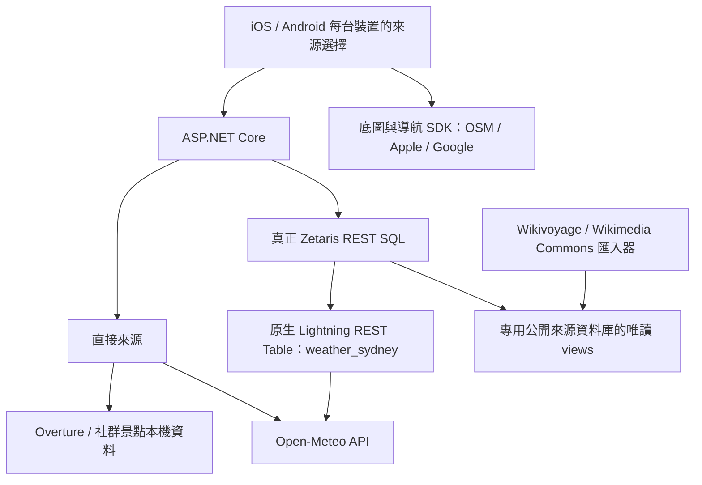

# Zetaris 旅遊資料整合（本機）

目前 iOS / Android 均可在「我的 → 旅遊資料來源」選擇 **直接來源** 或 **透過 Zetaris**。真正 Zetaris 已在本機執行，並非以 PostgreSQL 或測試伺服器代替。開發分支：`feat/zetaris-local-data`，整合服務啟動與資料搬移文件。

實際平台：`/Users/linziqiao/zetaris-local/zetaris-platform`；管理頁 <http://localhost:3000>。憑證只存在私人安裝設定，手機不持有帳密或 SQL。平台曾在 Documents 目錄遇到檔案同步等待，因此改用獨立家目錄安裝。

## 資料路徑



- 每個手機請求透過 `X-Travel-Data-Source: direct|zetaris` 選擇來源，不改變其他裝置。
- 天氣每次呼叫 API：Zetaris 模式由 **Zetaris 引擎** 呼叫 Open-Meteo，不由 App 後端直連冒充。沒有天氣匯出、資料庫快照、應用程式記憶體快取或 `CACHE TABLE`；HTTP 回應為 `Cache-Control: no-store`。直接模式同樣不暫存。
- 地圖及行程說明頁打開時會重新查天氣；失敗顯示未知，不以已儲存行程中的舊預報冒充最新天氣。歷史行程本身仍保存當時的規劃證據。
- 此版預報為固定雪梨市中心座標、Australia/Sydney 時區的未來七日預報；不是每個景點的微氣候。每次查詢都是新的 API 請求，預報數值仍依 Open-Meteo 的模型更新節奏變動。
- 店家、候選目錄、社群景點與底圖設定可以保存及快取，與天氣的生命週期分離。公開資料快照快取 15 秒，上限 20,000 筆；不是全球全量查詢架構。
- Zetaris 連線失敗明確報錯，可手動切回直接來源；不會靜默混用另一個來源。

| 資料 | Zetaris 表／來源 | 內容 |
| --- | --- | --- |
| 店家、餐廳、設施 | `sydneybuddy_travel.travel_poi` | 5,968 筆 Overture 公開地點、座標及來源版本 |
| OSM 地圖資訊 | `sydneybuddy_travel.travel_osm_places` | 5,318 筆公開地點：207 筆住宿、1,992 筆店家、2,276 筆餐飲、627 筆探索候選、183 筆一般景點及 33 筆設施 |
| 行程候選目錄 | `sydneybuddy_travel.travel_catalog` | 8 個既有示範景點；費用／開放時段仍是規劃假設 |
| 天氣 | `sydneybuddy_live.weather_sydney` | 原生 REST Table 每次讀取 Open-Meteo |
| 私房景點候選 | `sydneybuddy_travel.travel_hidden_gems` | 12 個社群探索地點、座標、指南版本及到達介紹；10 筆照片資料 |
| 底圖設定 | `sydneybuddy_travel.travel_map_layers` | 4 個供應商設定中繼資料，未保存圖磚或導航路線 |
| 地點版本 | `sydneybuddy_travel.travel_metadata` | Overture 版本、原始下載日期、涵蓋範圍 |

舊 `travel_weather` view 保留為相容名稱，但來源資料已清空、引擎快取已移除，App 不再查詢它。

## 私房景點資料包

搜尋頁預設「全部」，可橫向切換「景點、私房景點、餐飲、住宿、店家、生活設施」。全部及私房分類查詢附近 5 km，其他分類附近 1.5 km。Zetaris 模式整合 Overture、OSM 與 Wikivoyage，直接 OSM 模式從相同本機資料搜尋；直接 Apple／Google 模式維持原生搜尋及對應分類，私房分類仍由公開集合提供。公開資料與底圖獨立：Apple / Google 底圖也能顯示社群探索集合。在 Zetaris 模式從 Zetaris 查詢；直接模式從同批本機匯入資料查詢。

首批包含 Wendy Whiteley's Secret Garden、Sawmillers Reserve、Balls Head Reserve、Berry Island Reserve、Cremorne Reserve、Blues Point Reserve、Trim the Cat 等。這是有來源的編輯探索清單，**並非量測過遊客數的冷門排行**。

每筆保存：

- 穩定 ID、名稱、緯經度、原始座標出處、介紹、來源文章 revision、擷取日期。
- `guide.directions`：來源確實提供的到達說明。缺值標未知，不推測入口、公車號碼或步道路線；實際導航仍用既有路由服務。
- `photos[]`：Commons 圖片／縮圖 URL、檔案頁、作者、逐張授權、授權 URL、配對方式。保存照片資料及連結，沒有下載原始圖檔。
- 照片配對區分來源指南指定檔案與附近座標候選。附近照片另以名稱關鍵字篩選，畫面標示「景點配對未確認」，不保證拍攝的就是該景點。
- `reviews[]`：可擴充真正評論；這批 Wikivoyage 沒有旅客評論／星等，所以為空且畫面明示未提供。介紹不當成評論。
- `accessStatus=unverified`：指南描述不是對當日開放、可進入或道路安全的即時確認。

照片可以在景點介紹頁直接看到；指南、照片作者與授權會保留到工具箱及時間軸候選資料。指南文字為 CC BY-SA 4.0，保留版本連結；照片各自保留來源與授權，不統一改成同一張授權。

本版採用免金鑰的 Wikimedia 來源；Flickr、Mapillary API、Unsplash、Pexels 尚未接入。Mapillary 既有外部街景入口保留。沒有以風景庫存照片冒充該景點實拍，也沒有新增使用者上傳／社群發文功能。

## 啟動／更新

使用官方帳號取得的 `zetaris-platform.zip`、配套設定與映像版本。安裝依 [官方指南](https://github.com/zetaris/getting-started/blob/main/docs/install/updated_zetaris_installation_guide.md)。本機低資源設定為引擎 local[2] / 2 GB、API heap 1 GB，UI／API／JDBC 分別為 loopback 3000／8888／10000。官方安裝檢查先前已 9 項通過。

1. 在平台目錄執行 `docker compose up -d`，保留既有 volume。
2. 在 App 專案根目錄準備／匯入公開地點資料：

```sh
python3 scripts/prepare_zetaris_data.py
python3 scripts/import_hidden_gems.py
python3 scripts/import_osm_map_places.py
docker compose --env-file infra/zetaris/.env.local -f infra/zetaris/compose.source.yaml up -d --wait
docker compose --env-file infra/zetaris/.env.local -f infra/zetaris/compose.source.yaml exec -T source-db psql -U travel_source_admin -d travel_public < infra/zetaris/sql/import.sql
docker compose --env-file infra/zetaris/.env.local -f infra/zetaris/compose.source.yaml exec -T source-db psql -U travel_source_admin -d travel_public < infra/zetaris/sql/import-hidden-gems.sql
docker compose --env-file infra/zetaris/.env.local -f infra/zetaris/compose.source.yaml exec -T source-db psql -U travel_source_admin -d travel_public < infra/zetaris/sql/import-osm-map-places.sql
```

私人 `.env.local` 已存在時不要覆寫。首次建立才由 `.env.example` 準備獨立密碼。資料庫採獨立 volume 與 loopback 55433，不修改 App 的使用者資料庫。匯入以交易更新專用公開資料表，拒絕空資料。Zetaris 只用 `travel_reader` 讀 view。

3. 初次註冊一般公開來源仍可用 `scripts/load_zetaris_local.py --register`（需要 `scripts/requirements-zetaris.txt`、本機 JDK、官方 JDBC JAR）。再設定／核對即時天氣與社群 view：

```sh
python3 scripts/configure_zetaris_travel.py \
  --platform-env /Users/linziqiao/zetaris-local/zetaris-platform/.env --register
```

該腳本只建立缺少的已知名稱，移除天氣原生表的顯式快取，並做兩次即時預報查詢及景點 ID／筆數核對。不傳送手機 SQL，不印登入 token。省略 `--register` 只驗證。

4. 啟動 App 後端：

```sh
Zetaris__EnvironmentFile=/Users/linziqiao/zetaris-local/zetaris-platform/.env \
  dotnet run --project server-dotnet/SydneyBuddy.Api
```

後端使用該版本 UI 登入及 OpenAPI 定義的 SQL API。可覆寫 `Zetaris__BaseUrl`（預設 `http://127.0.0.1:8888`）與 `Zetaris__LoginUrl`（預設 `http://127.0.0.1:3000/api/auth/login`）。這是本機連接器，限制 loopback HTTP；正式部署需要 HTTPS 與服務身分設定。

資料檔 `travel-records.csv`、`hidden-gems.csv`、`hidden-gems.json`、manifest 位於已忽略的 `infra/zetaris/data/`，可由腳本重建，不提交憑證或資料包到 Git。

## 已知的 Zetaris 發行版限制

這個 2.4.3.1 實例先前對未快取的 JDBC view 執行篩選 COUNT／LIMIT 曾得到錯誤筆數；對小型平面 view 使用 `CACHE TABLE` 後才正確。App 現在不將搜尋條件下推，而是查詢有上限的完整公開快照，再用共用搜尋規則過濾。這個限制不應以快取天氣解決：天氣獨立走原生 REST Table，無 COUNT、LIMIT 篩選下推，也不快取。

`load_zetaris_local.py --cache` 僅針對靜態公開來源。其引擎記憶體快取在重啟後消失，來源更新後須先 `UNCACHE TABLE` 再重建／驗證。不要快取 `sydneybuddy_live.weather_sydney`。沒有直接處理全球 Overture 巢狀 Parquet；官方也有相關[問題紀錄](https://github.com/zetaris/getting-started/blob/main/open_data/parquet_csv/sql/known_to_fail/ISSUE-05-overture.md)。

## 檔案與測試

- `TravelDataService.cs`：裝置來源隔離、固定 Zetaris SQL、無天氣快取的 API 連接。
- `UnifiedPoiService.cs`：整合三個公開來源，依距離／分類／名稱搜尋；同名同分類且距離 25 公尺內才合併，保留來源清單與最完整介紹。僅同名的不同分店不合併。
- `scripts/import_osm_map_places.py`：一次匯入雪梨有界範圍的 OSM 觀景點、歷史地點、瀑布、住宿、店家與餐飲，排除標示 private/no 的地點，不以 OSM 標籤推論人氣。瀑布使用 `waterway=waterfall`。
- `HiddenGemService.cs`：社群景點半徑／文字搜尋、來源選擇及照片資料。
- `scripts/import_hidden_gems.py`：Wikivoyage 條目與 Commons 授權照片匯入。
- `scripts/configure_zetaris_travel.py`：原生 REST 表與社群 view 的建立／實例驗證。
- `sql/import-hidden-gems.sql`：公開資料交易匯入及唯讀權限。
- iOS / Android 搜尋與介紹頁：私房分類、座標、到達說明、評論狀態、照片署名與加入工具箱。

測試包含天氣每次重新呼叫、Zetaris 失敗不 fallback、不讀預報快照、指南／照片保留、無評論時不補假評分、拒絕無署名／不相容授權照片及無效座標。停止服務用 `docker compose stop` 保留 volume，不使用 `down -v`。

來源：[Open-Meteo API](https://open-meteo.com/en/docs)、[服務條款](https://open-meteo.com/en/terms)、[Wikivoyage 文字授權](https://en.wikivoyage.org/wiki/Wikivoyage:Copyleft)、[Commons Imageinfo API](https://www.mediawiki.org/wiki/API:Imageinfo)、[GeoSearch API](https://www.mediawiki.org/wiki/API:Geosearch)、[Zetaris REST 連接器指南](https://github.com/zetaris/getting-started/blob/main/open_data/rest_apis/HOWTO.md)。

### 本次驗證結果（2026-10-24）

- iOS 模擬器：51 項測試通過，包含 Apple 底圖下由後端取得社群景點及保留照片／指南契約。
- Android：27 項單元測試與新增的社群分類／介紹畫面裝置測試通過。
- ASP.NET Core：152 項測試通過；Python 匯入與設定檢查：11 項通過。
- 真正 Zetaris：12 個景點、10 筆照片資料；兩次原生天氣 SELECT 的 API generation time 不同，確認不是讀取同一筆引擎快照。
- App API：direct／zetaris 都成功搜尋 Wendy’s Secret Garden、讀取 2 筆照片、重算時間軸並保留指南與照片資料；連續兩次 `/weather` 都返回 `live=true, cached=false` 及 `Cache-Control: no-store`。

### 統一搜尋實測

真實 App API 的 direct／zetaris 回傳相同的整合結果。市中心 5 km 查詢在合併前有 11,298 筆來源記錄；按分類與半徑過濾後顯示最多 80 筆。空白「全部」搜尋會保留各分類名額，避免餐飲過多擠掉住宿與探索地點。每筆標示來源；同一位置保留指南、照片與其他來源的聯絡資料。資料有限定匯入範圍，並非原生底圖所有 POI 或全球商家全集；有截斷會提示輸入名稱或縮小分類。住宿候選可加入工具箱，尚未代表預訂或已設定當晚住宿。

已驗證「全部」可找到 Wendy’s Secret Garden；住宿、店家、餐飲、私房景點、設施都有實際結果。Android 新增裝置測試驗證預設全部及同頁切換住宿；iOS 51 項測試通過，後端 152 項測試通過。

## 搬移到 AWS Zetaris

執行 `python3 scripts/package_zetaris_migration.py` 可產生公開資料壓縮包；[搬移說明](migration/README.md) 包含 AWS 來源 DB 匯入、唯讀角色、Zetaris 登錄及天氣即時 API 設定。此工具不會上傳或部署。

## 交通、人潮與價格資訊

已加入手機地圖的「交通・人潮・費用」入口、原生 Zetaris 路況與 OSM 收費 API。範圍、金鑰條件、部分失敗與未知狀態請看 [INSIGHTS.md](INSIGHTS.md)。

## 本機與 AWS 服務啟動教學

完整步驟見 [SERVICE-STARTUP.md](migration/SERVICE-STARTUP.md)。在專案根目錄可用 `bash scripts/zetaris_local.sh start` 啟動已安裝的官方平台，`status` 檢查、`verify` 驗證、`stop` 保留資料並暫停。啟動教學會自動加入搬移 ZIP。

## 社群貼文與餐廳推薦

新增可選的 `travel_social_places` view：ASP.NET Core 保存原始匯入和證據，再同步已發布的公開 POI 至專用來源庫。完整操作與目前平台限制見 [社群靈感匯入](../../docs/social/README.md)。既有部署需先同步／註冊表，再開啟 `Zetaris__SocialEnabled=true`。

餐廳菜單與餐費估算：執行 `scripts/sync_social_zetaris.py --restaurants --register --platform-env <私人設定路徑>` 同步至 `travel_restaurant_places`，再開啟 `Zetaris__RestaurantsEnabled=true`。詳見 [餐廳資料流程](../../docs/social/RESTAURANT-DATA.md)。
